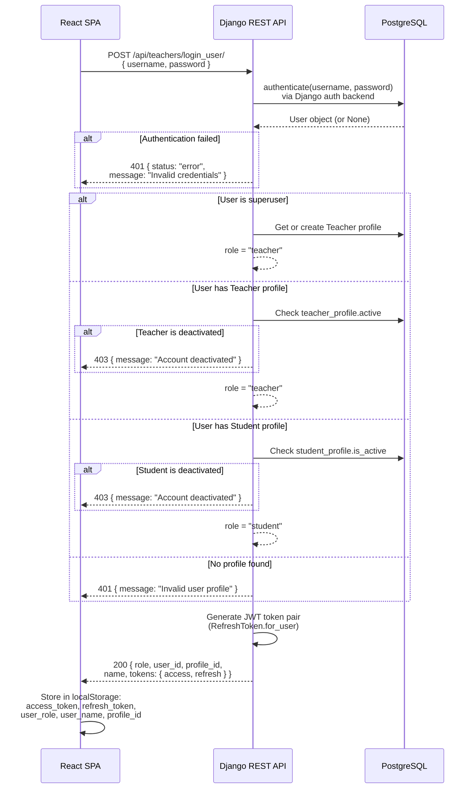
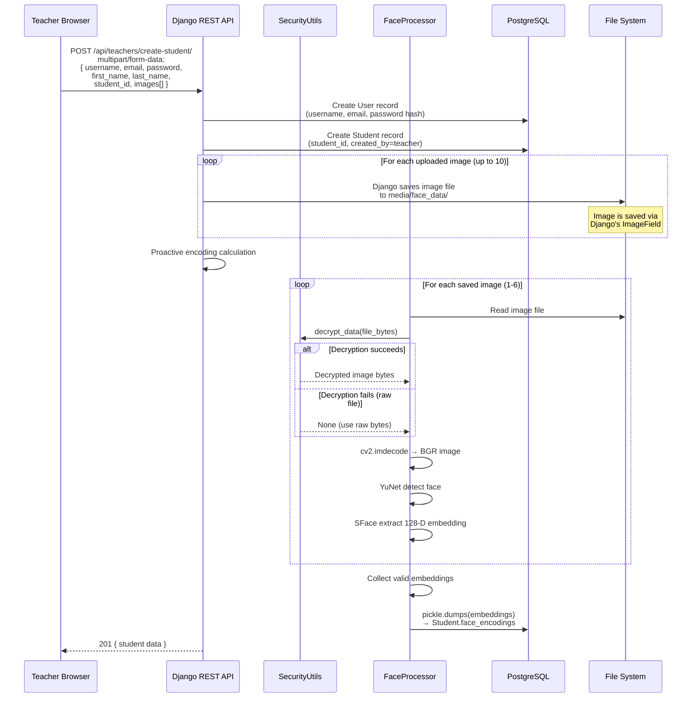
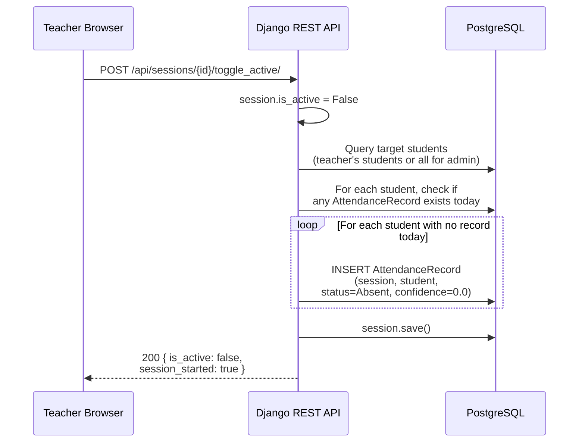
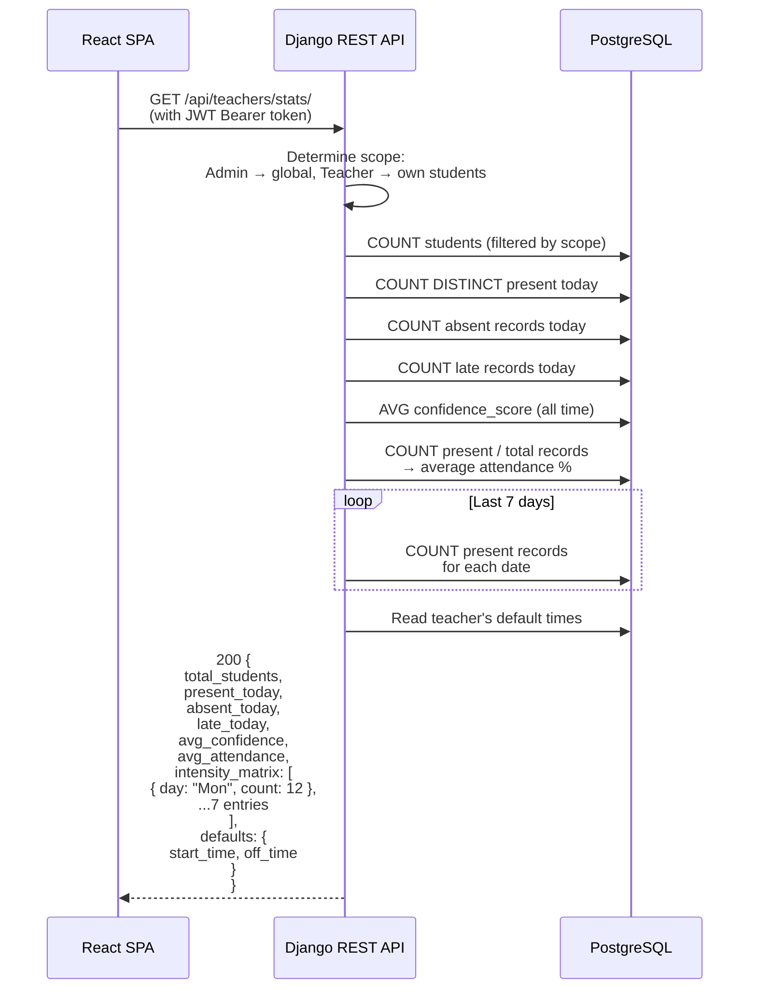
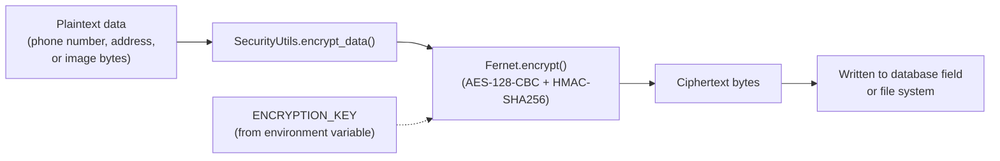
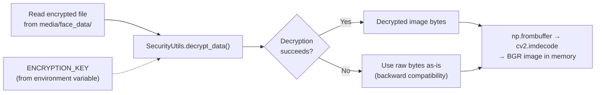

# Data Flow

## AI-Powered Smart Attendance Management System

> **Document type:** Data flow specification  
> **Project scope:** Collaborative final-year project — BS Computer Science

---

## Table of Contents

1. [Overview](#1-overview)
2. [User Authentication Flow](#2-user-authentication-flow)
3. [Student Enrollment and Biometric Registration Flow](#3-student-enrollment-and-biometric-registration-flow)
4. [Live Attendance Session — Frame Processing Flow](#4-live-attendance-session--frame-processing-flow)
5. [Session End — Automated Absent Marking Flow](#5-session-end--automated-absent-marking-flow)
6. [Dashboard Analytics Data Flow](#6-dashboard-analytics-data-flow)
7. [Encryption and Decryption Flows](#7-encryption-and-decryption-flows)
8. [API Endpoint Summary](#8-api-endpoint-summary)

---

## 1. Overview

This document traces how data moves through the system for each major workflow: authentication, student enrollment, real-time face recognition, session management, and analytics. Each section includes a diagram showing the actual sequence of operations as implemented in the codebase.

**Conventions used in diagrams:**
- Solid arrows represent synchronous request/response flows.
- Dashed arrows represent data reads from storage.
- Data formats (JSON, Base64, binary) are annotated where relevant.

---

## 2. User Authentication Flow

All three user roles (administrator, teacher, student) authenticate through the same login endpoint. The backend determines the role by checking which profile model is associated with the Django `User` account.



**Token refresh:** When the access token expires, the frontend can call `POST /api/token/refresh/` with the refresh token to obtain a new access/refresh pair. The old refresh token is blacklisted.

**Logout:** The frontend calls `logoutUser()` which clears `localStorage` entries (`access_token`, `refresh_token`, `user_role`, `user_name`) and reloads the page. There is no server-side logout endpoint — the access token remains valid until it expires.

---

## 3. Student Enrollment and Biometric Registration Flow

Teachers create student accounts and upload face images through the Student Management page. The backend stores the images, encrypts them, and proactively computes face embeddings.



**Data stored per student:**

| Field | Format | Storage | Encrypted? |
|-------|--------|---------|-----------|
| `username`, `email`, `first_name`, `last_name` | Plaintext strings | `auth_user` table | No |
| `password` | PBKDF2-SHA256 hash | `auth_user` table | Hashed (not encrypted) |
| `student_id` | Plaintext string | `main_student` table | No |
| `address` | Fernet-encrypted text | `main_student` table | Yes |
| `phone_number` | Fernet-encrypted text | `main_student` table | Yes |
| `img1` – `img10` | Image files | `media/face_data/` | Yes (Fernet) |
| `face_encodings` | Pickled Python list of NumPy arrays | `main_student` table (BinaryField) | No |
| `profile_pic` | Image file | `media/student_profiles/` | No |

---

## 4. Live Attendance Session — Frame Processing Flow

This is the core data flow of the system. During an active session, the teacher's browser captures webcam frames and sends them to the backend for face recognition.

```mermaid
sequenceDiagram
    participant Camera as Webcam
    participant Browser as React SPA
    participant API as Django REST API
    participant AI as FaceProcessor
    participant DB as PostgreSQL

    Note over Browser: Session is active,<br/>camera is streaming

    Camera->>Browser: Raw video frames<br/>(getUserMedia stream)

    loop Every capture interval
        Browser->>Browser: Draw frame to hidden canvas<br/>Export as Base64 JPEG (quality 0.6)
        Browser->>API: POST /api/sessions/{id}/process_frame/<br/>{ frame: "data:image/jpeg;base64,..." }

        API->>API: Check session.is_active == True
        API->>API: Check current time within<br/>[start_time, off_time]
        API->>API: Check no admin session<br/>has precedence (if teacher session)

        alt Validation fails
            API-->>Browser: 400/403/423 error response
        end

        API->>AI: Check if training cache is current
        alt Cache needs refresh
            AI->>DB: Load all active students<br/>(filtered by teacher or all for admin)
            AI->>AI: train_students() →<br/>build in-memory embedding matrix
        end

        API->>AI: identify(frame_base64)

        AI->>AI: base64_to_cv2(frame)<br/>→ BGR NumPy array
        AI->>AI: YuNet detect faces
        
        loop For each detected face
            AI->>AI: SFace alignCrop + feature<br/>→ 128-D query embedding
            AI->>AI: Vectorized cosine similarity<br/>query · library_matrix^T / norms
            AI->>AI: Find argmax similarity

            alt Similarity >= 0.45
                AI->>AI: check_liveness(face, student_pk)<br/>EMPR temporal variance check
                
                alt Liveness passed
                    AI-->>API: { student_id, confidence,<br/>box, is_live: true }
                else Liveness pending
                    AI-->>API: { student_id, confidence,<br/>box, is_live: false }
                end
            else Similarity 0.38-0.44
                AI-->>API: Uncertain match
            else Similarity < 0.38
                AI-->>API: No match
            end
        end

        AI-->>API: List of detection results

        loop For each verified detection (>= 0.45, is_live)
            API->>DB: Check if student already<br/>marked present today
            alt Not yet marked
                API->>DB: INSERT AttendanceRecord<br/>(status=Present,<br/>confidence_score, is_late)
            else Already marked present
                API-->>API: Skip (no duplicate)
            else Has absent record from earlier
                API->>DB: UPDATE existing record<br/>→ status=Present
            end
        end

        API-->>Browser: 200 { detections: [...],<br/>active_monitor: true }
        Browser->>Browser: Draw bounding boxes<br/>on overlay canvas
        Browser->>Browser: Update detection log UI
    end
```

### Cosine Similarity Computation Detail

The matching step avoids iterating over students one-by-one. Instead:

1. All library embeddings are stacked into a matrix $\mathbf{M} \in \mathbb{R}^{P \times 128}$ (where $P$ = total stored embeddings across all students).
2. The query embedding $\mathbf{q} \in \mathbb{R}^{128}$ is dotted against all rows simultaneously:

$$\text{similarities} = \frac{\mathbf{M} \cdot \mathbf{q}}{\|\mathbf{M}\|_{\text{rows}} \cdot \|\mathbf{q}\| + \epsilon}$$

3. The index of the maximum value is extracted via `np.argmax`.

This takes a single NumPy operation regardless of how many students are enrolled.

### Confidence Score Transformation

The raw cosine similarity (range 0.45–1.0) is mapped to a display percentage for the UI:

$$\text{display} = \min\left(99.9, \; 92 + (s - 0.45) \times 14.5\right)$$

where $s$ is the raw similarity score. This mapping was chosen to present scores in a range that is more intuitive for non-technical users.

---

## 5. Session End — Automated Absent Marking Flow

When a teacher stops an active session, the backend automatically marks any students who were not recorded as present for that calendar day.



**Important behavior:** The absent check looks for records across **all sessions for that day**, not just the current session. If a student was marked present in an earlier session, they will not be marked absent when a later session ends.

---

## 6. Dashboard Analytics Data Flow

The teacher dashboard calls the stats endpoint on page load to populate analytics widgets.



**Data displayed on the dashboard:**

| Widget | Data Source |
|--------|-----------|
| Total Students card | `total_students` — count of students in scope |
| Present Today card | `present_today` — distinct students present today |
| Absent Today card | `absent_today` — absent records today |
| Late Today card | `late_today` — late records today |
| Average Attendance | `avg_attendance` — percentage across all records |
| AI Confidence | `avg_confidence` — mean confidence score |
| Weekly Heatmap | `intensity_matrix` — 7-day present counts |

---

## 7. Encryption and Decryption Flows

### 7.1 Encrypting Data at Rest



### 7.2 Decrypting Biometric Images for AI Processing



> [!NOTE]
> Decrypted image data exists only in memory (as a NumPy array) during processing. It is not written back to disk in plaintext. However, the face embeddings derived from these images are stored unencrypted in the database as pickled binary data.

---

## 8. API Endpoint Summary

This table lists all API endpoints, their HTTP methods, authentication requirements, and the data they accept and return.

### Teacher Endpoints (`/api/teachers/`)

| Endpoint | Method | Auth Required | Request Data | Response Data |
|----------|--------|--------------|-------------|--------------|
| `/api/teachers/login_user/` | POST | No | `{ username, password }` | `{ role, user_id, profile_id, tokens: { access, refresh } }` |
| `/api/teachers/register_teacher/` | POST | No | `{ email, password, first_name, last_name, department }` | Teacher object |
| `/api/teachers/stats/` | GET | Yes | — | Analytics summary (see Section 6) |
| `/api/teachers/create-student/` | POST | Yes | `multipart: { username, email, password, student_id, images[] }` | Student object |
| `/api/teachers/train_ai/` | POST | Yes | — | `{ status, report: { total, success, failed } }` |
| `/api/teachers/{id}/toggle-active/` | POST | Yes (admin) | — | `{ active, message }` |
| `/api/teachers/{id}/update-profile/` | PATCH | Yes | `multipart: { email, first_name, last_name, department, profile_pic, password }` | `{ status, message }` |
| `/api/teachers/{id}/change-password/` | POST | Yes | `{ new_password }` | `{ status, message }` |
| `/api/teachers/clear-records/` | POST | Yes (admin) | — | `{ message }` (deletes all sessions and records) |

### Student Endpoints (`/api/students/`)

| Endpoint | Method | Auth Required | Request Data | Response Data |
|----------|--------|--------------|-------------|--------------|
| `/api/students/` | GET | Yes | — | List of students (filtered by role) |
| `/api/students/{id}/` | GET | Yes | — | Single student object |
| `/api/students/{id}/` | PATCH | Yes | `{ name, student_id, address, phone_number, email }` | Updated student object |
| `/api/students/{id}/` | DELETE | Yes | — | 204 No Content |
| `/api/students/{id}/update-profile/` | PATCH | Yes | `multipart: { email, ... }` | Updated student object |
| `/api/students/{id}/toggle-status/` | POST | Yes | — | `{ is_active, message }` |

### Session Endpoints (`/api/sessions/`)

| Endpoint | Method | Auth Required | Request Data | Response Data |
|----------|--------|--------------|-------------|--------------|
| `/api/sessions/` | GET | Yes | — | List of all sessions with nested records |
| `/api/sessions/` | POST | Yes | `{ teacher, course_name, section_name, camera_source, camera_url, camera_port, start_time, off_time }` | Session object |
| `/api/sessions/{id}/toggle_active/` | POST | Yes | — | `{ is_active, session_started, started_at }` |
| `/api/sessions/{id}/process_frame/` | POST | Yes | `{ frame: "base64..." }` | `{ detections: [...], active_monitor: true }` |
| `/api/sessions/test_connection/` | POST | Yes | `{ camera_url, camera_port }` | `{ connected: bool, message/error }` |

### Record Endpoints (`/api/records/`)

| Endpoint | Method | Auth Required | Request Data | Response Data |
|----------|--------|--------------|-------------|--------------|
| `/api/records/` | GET | Yes | — | List of all attendance records |
| `/api/records/{id}/` | DELETE | Yes | — | 204 No Content |

### Token Endpoints

| Endpoint | Method | Auth Required | Request Data | Response Data |
|----------|--------|--------------|-------------|--------------|
| `/api/token/refresh/` | POST | No | `{ refresh: "token..." }` | `{ access: "new_token", refresh: "new_refresh" }` |

---

<div align="center">

*This document describes the data flows as actually implemented in the codebase. It is intended for academic evaluation and portfolio presentation.*

</div>
