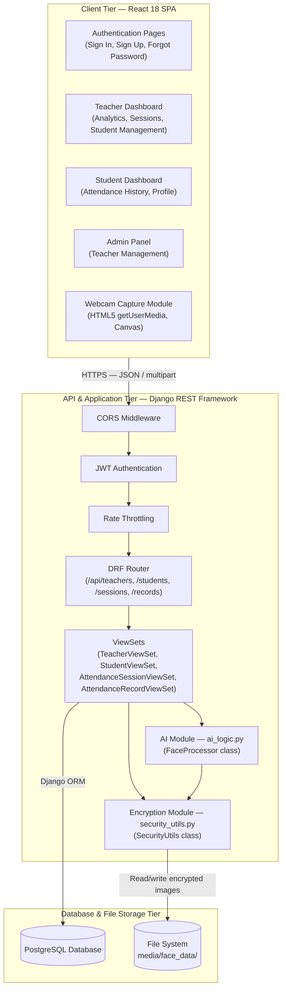
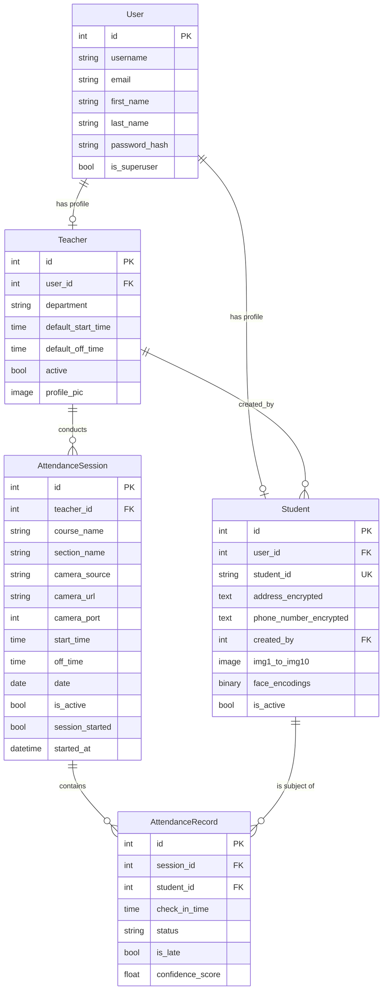
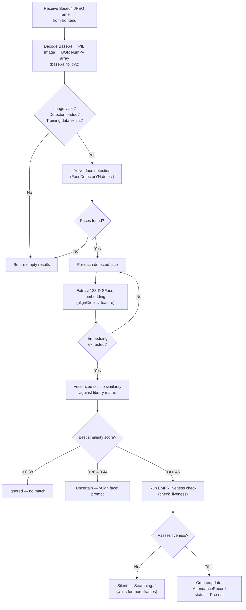
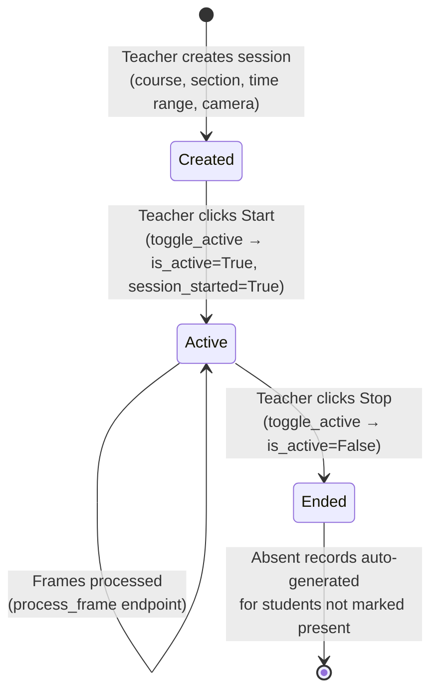

# System Architecture

## AI-Powered Smart Attendance Management System

> **Document type:** Technical architecture reference  
> **Project scope:** Collaborative final-year project — BS Computer Science  
> **Focus areas:** Computer vision, access control, and biometric data privacy

---

## Table of Contents

1. [Overview](#1-overview)
2. [High-Level Architecture](#2-high-level-architecture)
3. [Tier Breakdown](#3-tier-breakdown)
   - [3.1 Client Tier (React SPA)](#31-client-tier-react-spa)
   - [3.2 API and Middleware Tier (Django REST Framework)](#32-api-and-middleware-tier-django-rest-framework)
   - [3.3 Application Logic Tier](#33-application-logic-tier)
   - [3.4 Computer Vision Subsystem](#34-computer-vision-subsystem)
   - [3.5 Encryption Subsystem](#35-encryption-subsystem)
   - [3.6 Database and Storage Tier](#36-database-and-storage-tier)
4. [Data Model and Relationships](#4-data-model-and-relationships)
5. [Authentication and Access Control](#5-authentication-and-access-control)
6. [AI Recognition Pipeline](#6-ai-recognition-pipeline)
7. [Liveness Checking (EMPR)](#7-liveness-checking-empr)
8. [Session Lifecycle](#8-session-lifecycle)
9. [Deployment Topology](#9-deployment-topology)
10. [Known Limitations](#10-known-limitations)

---

## 1. Overview

The AI-Powered Smart Attendance Management System is a three-tier web application that uses facial recognition to automate classroom attendance. It was developed as an academic group project and is not intended as a production-ready commercial product.

The system consists of:

- A **React 18** single-page application (SPA) that provides dashboards for teachers, students, and administrators, and captures webcam frames for facial recognition.
- A **Django REST Framework** backend that handles authentication, session management, attendance logic, and delegates facial recognition to an OpenCV-based AI module.
- A **PostgreSQL** database for persistent storage, with Fernet-encrypted fields for sensitive student data and biometric images stored on the local file system.

The overall goal is to reduce the time spent on manual roll calls and to explore how authentication, role-based access, and biometric privacy can be addressed in a software system that handles sensitive data.

---

## 2. High-Level Architecture

The system follows a standard **three-tier architecture** (client → API server → database), with the computer vision pipeline running as an in-process Python module on the backend server.



> [!NOTE]
> The AI module (`FaceProcessor`) runs **in the same process** as the Django application server. It is not a separate microservice. Face detection and recognition models are loaded into memory once at startup and reused across requests.

---

## 3. Tier Breakdown

### 3.1 Client Tier (React SPA)

The frontend is a single-page application built with **React 18.2** and **React Router v6**. It communicates with the backend exclusively through REST API calls using **Axios**.

**Key components:**

| Module | File(s) | Responsibility |
|--------|---------|---------------|
| API Client | `src/api/index.js` | Axios instance with JWT interceptors (attaches `Authorization: Bearer` header, handles 401 redirects) |
| Layout | `src/components/Layout.js`, `Header.js`, `Sidebar.js`, `Footer.js` | Shared page structure and navigation |
| Teacher Pages | `src/pages/teacher/TeacherDashboard.js`, `AttendanceSession.js`, `StudentManagement.js`, `TeacherProfile.js` | Dashboard analytics, live attendance sessions with webcam, student CRUD, profile settings |
| Student Pages | `src/pages/student/StudentDashboard.js`, `StudentProfile.js` | Personal attendance history and profile editing |
| Admin Pages | `src/pages/admin/TeacherManagement.js` | Teacher account activation/deactivation (superuser only) |
| Auth Pages | `src/pages/SignIn.js`, `SignUp.js`, `ForgotPassword.js` | Login (separate routes for teacher and student), registration |

**Client-side access control:**

A `ProtectedRoute` wrapper component in `App.js` checks `localStorage` for an access token and user role. If the token is missing or the role does not match the allowed roles for a route, the user is redirected to the sign-in page or their own dashboard. This is a UI convenience only — the actual authorization is enforced on the backend.

**Webcam frame capture:**

During a live attendance session, the `AttendanceSession` component:
1. Opens the user's webcam via `navigator.mediaDevices.getUserMedia()`.
2. Draws frames to a hidden `<canvas>` element.
3. Exports the canvas to a Base64 JPEG string (quality: 0.6) approximately every few seconds.
4. Sends the Base64 string to the backend `POST /api/sessions/{id}/process_frame/` endpoint.
5. Draws detection bounding boxes on a transparent overlay canvas positioned over the video feed.

### 3.2 API and Middleware Tier (Django REST Framework)

The Django backend is configured in `backend/backend/settings.py` with the following middleware stack (in order):

1. `SecurityMiddleware` — Sets security-related HTTP headers (`X-Frame-Options: DENY`, `X-Content-Type-Options: nosniff` when `DEBUG=False`).
2. `CorsMiddleware` (`django-cors-headers`) — Allows cross-origin requests from configured frontend origins (default: `http://localhost:3000`).
3. `SessionMiddleware`, `CommonMiddleware`, `CsrfViewMiddleware` — Standard Django middleware.
4. `AuthenticationMiddleware` — Processes Django session auth (used alongside JWT for the admin panel).
5. `XFrameOptionsMiddleware` — Clickjacking protection.

**API routing:**

All endpoints are registered under `/api/` using DRF's `DefaultRouter`:

| Prefix | ViewSet | Key Custom Actions |
|--------|---------|-------------------|
| `/api/teachers/` | `TeacherViewSet` | `login_user`, `register_teacher`, `stats`, `create-student`, `train_ai`, `toggle-active`, `clear-records`, `update-profile`, `change-password` |
| `/api/students/` | `StudentViewSet` | `update-profile`, `toggle-status` |
| `/api/sessions/` | `AttendanceSessionViewSet` | `toggle_active`, `process_frame`, `test_connection` |
| `/api/records/` | `AttendanceRecordViewSet` | (standard CRUD only) |
| `/api/token/refresh/` | SimpleJWT `TokenRefreshView` | (token refresh) |

**Rate throttling:**

Configured via DRF's built-in throttle classes:
- Anonymous: 1,000 requests/day
- Authenticated: 100,000 requests/day

### 3.3 Application Logic Tier

The core business logic is implemented in `backend/main/views.py` (754 lines) across four ViewSets. Key behaviors:

**Attendance recording:**
- When the AI module identifies a student with sufficient confidence (≥ 0.45) and the liveness check passes, an `AttendanceRecord` is created with status `Present`, the AI's confidence score, and whether the student was late (compared against the session's `start_time`).
- A student can only be marked present **once per calendar day** across all sessions. Duplicate detections are silently ignored.
- When a session is stopped (`toggle_active`), any enrolled student who was not marked present for that day is automatically given an `Absent` record.

**Admin precedence:**
- If an administrator's session is active, teacher-level sessions receive an `HTTP 423 Locked` response when attempting to process frames. This prevents conflicting attendance records.

**Statistics endpoint (`/api/teachers/stats/`):**
- Returns: total students, present today, absent today, late today, average confidence, average attendance percentage, and a 7-day attendance intensity matrix (used for the dashboard heatmap).

### 3.4 Computer Vision Subsystem

Implemented in `backend/main/ai_logic.py` (284 lines) as the `FaceProcessor` class, instantiated as a module-level singleton `ai_engine`.

**Models used:**
- **Detection:** `face_detection_yunet_2023mar.onnx` — OpenCV's YuNet face detector, loaded via `cv2.FaceDetectorYN.create()`.
- **Recognition:** `face_recognition_sface_2021dec.onnx` — OpenCV's SFace recognizer, loaded via `cv2.FaceRecognizerSF.create()`.

Both are pre-trained ONNX models shipped with the repository (in `backend/main/models/`). No custom model training is performed.

**In-memory embedding cache:**

During a session, the system calls `train_students()` which:
1. For each active student, checks if pickled face encodings exist in the database (`Student.face_encodings` — a `BinaryField`).
2. If cached encodings exist, unpickles them. Otherwise, reads each student's face images (up to 10), decrypts them if encrypted, runs YuNet detection + SFace embedding extraction, and pickles the results back to the database.
3. Stores all embeddings in a Python dict `trained_data = {student_pk: [embeddings]}`.

**Matching:**

The `identify()` method:
1. Decodes the incoming Base64 frame to a BGR image.
2. Runs YuNet to detect faces in the frame.
3. For each detected face, extracts a 128-dimensional SFace embedding.
4. Stacks all library embeddings into a NumPy matrix and computes cosine similarity against the query embedding using a vectorized dot product.
5. Returns the best match if similarity ≥ 0.38, along with liveness status.

**Thread safety:**

A `threading.Lock` protects access to the `trained_data` dictionary, since Django may handle concurrent requests.

### 3.5 Encryption Subsystem

Implemented in `backend/main/security_utils.py` (36 lines) as the `SecurityUtils` class.

- **Algorithm:** Fernet symmetric encryption (AES-128-CBC with HMAC-SHA256 authentication), provided by the `cryptography` Python library.
- **Key management:** The encryption key is read from the `ENCRYPTION_KEY` environment variable. If the variable is not set, the code generates a new random key at runtime (which means previously encrypted data would be unrecoverable — this fallback exists for development convenience, not production use).
- **What is encrypted:**
  - Student face images (files in `media/face_data/`) — encrypted before writing to disk.
  - Student phone numbers and addresses — stored as encrypted text in the database.
- **Decryption behavior:** The `decrypt_biometric_to_cv2()` method in the AI module attempts Fernet decryption. If decryption fails (e.g., the file was stored before encryption was enabled), it falls back to treating the data as a raw unencrypted image. This provides backward compatibility but means the system does not distinguish between "unencrypted file" and "corrupted encrypted file."

> [!IMPORTANT]
> The Fernet key is a single symmetric key shared across all encryption operations. There is no key rotation mechanism implemented. If the key is compromised, all encrypted data is exposed. These are documented limitations appropriate for an academic project.

### 3.6 Database and Storage Tier

**Database:** PostgreSQL, configured via environment variables (`DB_NAME`, `DB_USER`, `DB_PASSWORD`, `DB_HOST`, `DB_PORT`). Default database name is `face_recognition`.

**ORM:** Django's built-in ORM with the `psycopg2-binary` adapter.

**File storage:** Django's default `FileSystemStorage`. Biometric face images are uploaded to `media/face_data/`. Teacher and student profile pictures are uploaded to `media/teacher_profiles/` and `media/student_profiles/` respectively.

---

## 4. Data Model and Relationships



**Key constraints:**
- `AttendanceRecord` has a `unique_together` constraint on `(session, student)` — a student can only have one record per session.
- `Student.student_id` is a unique field separate from the database primary key.
- `Teacher.user` and `Student.user` are `OneToOneField` references to Django's built-in `User` model.
- `Student.created_by` uses `on_delete=SET_NULL`, so deleting a teacher does not delete their students.

---

## 5. Authentication and Access Control

### Authentication

The system uses **JWT (JSON Web Token)** authentication via `djangorestframework-simplejwt`:

- **Access token lifetime:** 60 minutes
- **Refresh token lifetime:** 24 hours
- **Token rotation:** Enabled — each refresh request issues a new refresh token and blacklists the old one.

The login endpoint (`POST /api/teachers/login_user/`) accepts a username (or email) and password, authenticates against Django's `User` model, and returns a token pair along with role information.

The frontend stores the access token in `localStorage` and attaches it as a `Bearer` token via an Axios request interceptor.

### Role-Based Access Control

The system defines three roles, determined by the user's profile:

| Role | Determined by | Capabilities |
|------|--------------|-------------|
| **Administrator** | `User.is_superuser = True` | Full access: all teacher and student data, teacher activation/deactivation, attendance record purge, global sessions |
| **Teacher** | Has a `Teacher` profile with `active = True` | Manage own students, run attendance sessions, view analytics for own class |
| **Student** | Has a `Student` profile with `is_active = True` | View own attendance records and profile |

**Backend enforcement:**
- `TeacherViewSet` uses `permissions.IsAuthenticated` as the default, with `AllowAny` overridden for `login_user` and `register_teacher`.
- Several actions explicitly check `request.user.is_superuser` and return `HTTP 403` if the user is not an admin (e.g., `toggle_active`, `clear_records`).
- `StudentViewSet.get_queryset()` filters results based on the requesting user's role — teachers see only students they created, students see only their own profile, admins see all.

> [!NOTE]
> Frontend route guards (the `ProtectedRoute` component) are a UX convenience. All actual authorization decisions are made on the backend through DRF permissions and queryset filtering.

---

## 6. AI Recognition Pipeline

The following diagram describes the actual processing steps implemented in `FaceProcessor.identify()`:



**Confidence score display:** The raw cosine similarity (range 0.45–1.0) is mapped to a display percentage (range 92%–99.9%) for the teacher's dashboard UI. This mapping is linear: `display = 92 + (raw - 0.45) × 14.5`.

---

## 7. Liveness Checking (EMPR)

The Eye-Mouth Position Ratio (EMPR) check is implemented in `FaceProcessor.check_liveness()`. It is a passive liveness method — it does not require user cooperation (blinking, head turning, etc.).

**How it works:**

1. From each detected face, extract 5 landmark coordinates (left eye, right eye, nose, left mouth corner, right mouth corner).
2. Compute two scale-invariant geometric ratios:
   - $r_1 = \frac{\text{mouth width}}{\text{inter-pupillary distance}}$
   - $r_2 = \frac{\text{nose-to-mouth-center distance}}{\text{inter-pupillary distance}}$
3. Maintain a sliding window of the last 10 ratio pairs per tracked student (within a 3-second window).
4. Compute the variance of the ratios across frames.
5. **Decision:** If `total_variance > 0`, the face is considered live. If variance is exactly zero (as with a static printed photo), the face is rejected.

**Bypass for high-confidence matches:** If the cosine similarity exceeds 0.65 and at least one prior frame was recorded, the liveness check is automatically passed. This reduces false rejections for clearly recognized individuals.

> [!WARNING]
> **Limitations of the EMPR approach:**
> - The check relies on exactly-zero variance to reject static photos. A photo held by a person whose hand trembles slightly could introduce enough variance to pass.
> - Video replays (playing a recorded video of the target on a screen) would likely pass, since the video contains natural facial motion.
> - The high-confidence bypass (> 0.65) skips liveness entirely, which weakens the anti-spoofing guarantee for well-enrolled students.
> - This is a basic geometric heuristic, not a trained anti-spoofing classifier. It has not been tested against a standardized presentation attack dataset.
>
> These are known limitations documented for academic evaluation.

---

## 8. Session Lifecycle



**Time enforcement:** The `process_frame` endpoint rejects requests if the current server time is outside the session's `[start_time, off_time]` window, returning `HTTP 403`.

**Camera sources:** The system supports two camera modes:
- **Webcam** — Frames are captured client-side via the browser's `getUserMedia()` API and sent as Base64.
- **IP Camera** — A URL (and optional port) can be configured. The `test_connection` endpoint validates the stream by attempting to open it with OpenCV's `VideoCapture` and reading one frame with a 3-second timeout.

---

## 9. Deployment Topology

As an academic project, the system is designed to run on a single development machine or a small local network:

```
┌──────────────────────────────────────────────────┐
│                Developer Machine                  │
│                                                    │
│  ┌─────────────┐    ┌─────────────────────────┐   │
│  │ React Dev   │    │ Django Dev Server        │   │
│  │ Server      │    │ (manage.py runserver)    │   │
│  │ Port 3000   │───▶│ Port 8000                │   │
│  └─────────────┘    │                           │   │
│                      │  ┌───────────────────┐   │   │
│                      │  │ FaceProcessor     │   │   │
│                      │  │ (in-process)      │   │   │
│                      │  │ YuNet + SFace     │   │   │
│                      │  │ ONNX models       │   │   │
│                      │  └───────────────────┘   │   │
│                      └────────────┬──────────────┘   │
│                                   │                   │
│                      ┌────────────▼──────────────┐   │
│                      │ PostgreSQL                 │   │
│                      │ Port 5432                  │   │
│                      │ Database: face_recognition │   │
│                      └────────────────────────────┘   │
│                                                        │
│  ┌──────────────────────────────────────────────────┐ │
│  │ File System: backend/media/                       │ │
│  │   face_data/   (encrypted student face images)    │ │
│  │   teacher_profiles/                                │ │
│  │   student_profiles/                                │ │
│  └──────────────────────────────────────────────────┘ │
└──────────────────────────────────────────────────────┘
```

For a production-like deployment, the system would require:
- A WSGI server (e.g., Gunicorn) behind a reverse proxy (e.g., Nginx) with HTTPS.
- Static file serving via Nginx or a CDN.
- Environment variables set securely (not in `.env` files accessible to the file system).

These are not implemented in the current version.

---

## 10. Known Limitations

This section documents architectural limitations honestly, as appropriate for an academic project:

| Area | Limitation |
|------|-----------|
| **Scalability** | The AI module runs in-process with a single shared `FaceProcessor` instance. Under heavy concurrent load (many simultaneous sessions), the `threading.Lock` would serialize all embedding lookups. |
| **Liveness detection** | The EMPR check is a basic geometric heuristic. It has not been evaluated against standardized attack datasets (e.g., CASIA-FASD, Replay-Attack). Video replay attacks would likely bypass it. |
| **Key management** | A single Fernet key is used for all encryption. It is stored as a plaintext environment variable. There is no key rotation, HSM integration, or key escrow mechanism. |
| **Session management** | JWT tokens are stored in `localStorage`, which is accessible to any JavaScript running on the page (XSS vulnerability surface). `httpOnly` cookies would be more secure but are not used. |
| **Model training** | No custom model training or fine-tuning is performed. The system uses pre-trained YuNet and SFace ONNX models as-is. Recognition accuracy depends on image quality and enrollment photo variety. |
| **Encryption fallback** | If the `ENCRYPTION_KEY` environment variable is not set, a random key is generated at runtime. This means encrypted data from previous runs cannot be decrypted. |
| **No HTTPS in development** | The default setup runs over plain HTTP. `SECURE_SSL_REDIRECT`, `SESSION_COOKIE_SECURE`, and `CSRF_COOKIE_SECURE` are all set to `False`. |
| **Client-side role check** | The `ProtectedRoute` component checks `localStorage` values, which can be modified by a user. Backend authorization is the actual enforcement layer. |

---

<div align="center">

*This document describes the system as actually implemented. It is intended for academic evaluation and portfolio presentation.*

</div>
