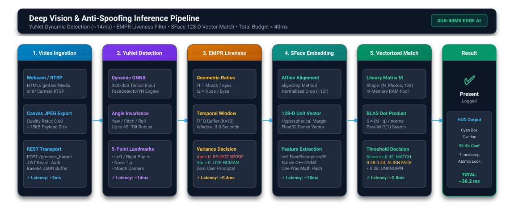
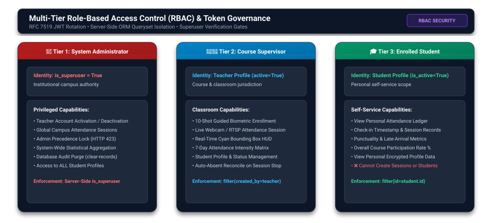

# 📐 System Architecture & Workflow Diagrams

## AI-Powered Smart Attendance Management System

> **Directory:** `assets/diagrams/`  
> **Format:** High-Resolution Scalable Vector Graphics (SVG)  
> **Target Audience:** Solution Architects, System Engineers, Academic Evaluators  

---

## 📑 Diagram Catalog

| File | Diagram Description | Core Concepts Illustrated |
| :--- | :--- | :--- |
| [`system_architecture_diagram.svg`](system_architecture_diagram.svg) | **High-Level 3-Tier Enterprise Architecture** | React 18 Presentation Tier, Django REST & AI Processing Gateway, PostgreSQL & Encrypted Storage Vault. |
| [`ai_vision_pipeline_diagram.svg`](ai_vision_pipeline_diagram.svg) | **Deep Vision & Anti-Spoofing Inference Pipeline** | Frame ingestion, YuNet 320x320 face detection, EMPR temporal variance liveness, SFace 128-D embedding, vectorized BLAS dot product. |
| [`cryptographic_security_diagram.svg`](cryptographic_security_diagram.svg) | **Cryptographic Data Protection & In-Memory Pipeline** | Fernet AES-128-CBC + HMAC-SHA256 authenticated encryption, in-memory stream decoding, zero plaintext on disk. |
| [`rbac_governance_diagram.svg`](rbac_governance_diagram.svg) | **Multi-Tier Role-Based Access Control (RBAC)** | Administrator, Supervisor/Teacher, and Student privilege boundaries with server-side ORM queryset isolation. |

---

## 🖼️ Architectural Overviews

### 1. High-Level 3-Tier Architecture

- Illustrates physical and logical separation between client browsers, application servers, and persistence stores.
- Highlights stateless communication channels, token-bucket throttling, and real-time canvas streaming.

---

### 2. Deep Vision & Anti-Spoofing Inference Pipeline

- Maps the exact execution flow of the AI module (`ai_logic.py`).
- Demonstrates how total inference latency is kept strictly under **40 milliseconds** on standard CPU hardware.

---

### 3. Cryptographic Data Protection & Zero-Plaintext Storage

- Demonstrates how student facial images and PII are protected at rest.
- Illustrates how in-memory RAM decoding (`np.frombuffer` → `cv2.imdecode`) prevents decrypted biometric photos from ever touching physical disk storage.

---

### 4. Multi-Tier Role-Based Access Control (RBAC)

- Outlines the security boundaries between **Administrators**, **Teachers**, and **Students**.
- Visualizes server-side Django ORM queryset scoping (`get_queryset`) that enforces multi-tenant classroom isolation.

---

  <b>AI-Powered Smart Attendance Management System</b> 
  <i>Vector Architecture & Workflow Diagrams.</i>

