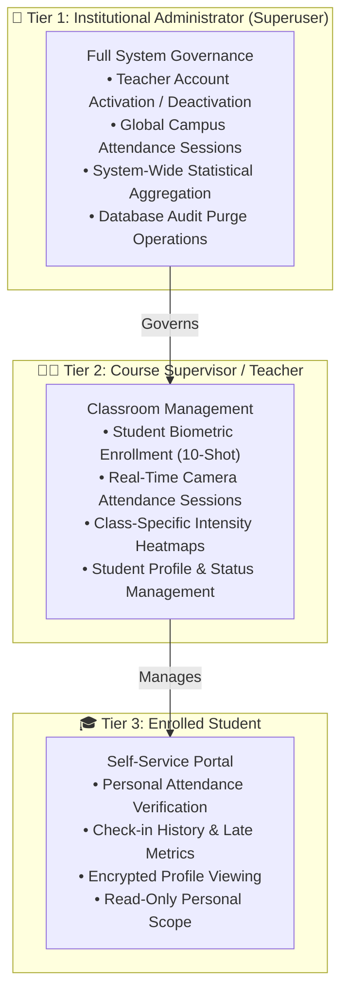
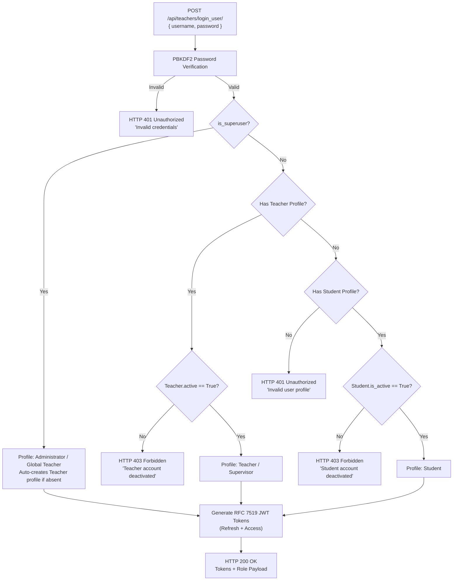
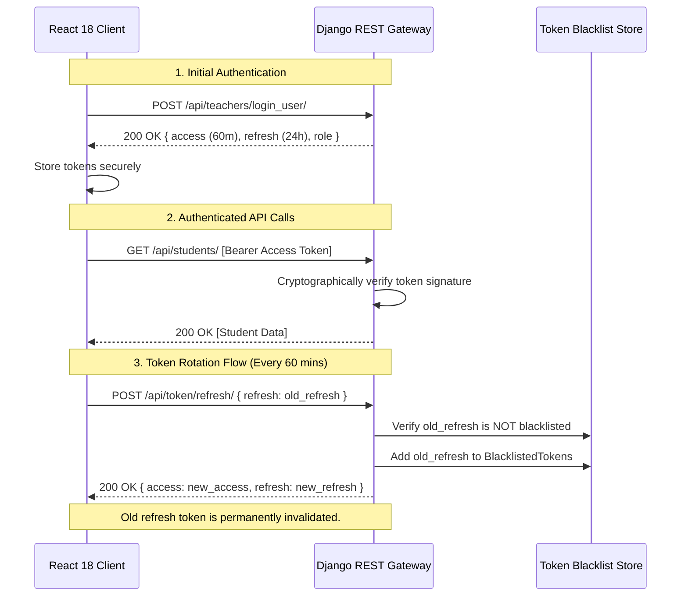
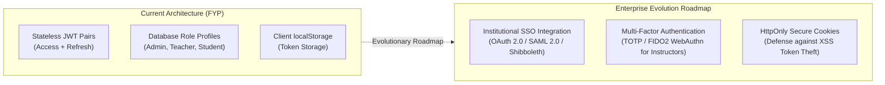

# Authentication & Role-Based Access Control (RBAC) Architecture

## AI-Powered Smart Attendance Management System

> **Document Type:** Identity, Authentication & Authorization Specification  
> **Project Scope:** Final Year Project (FYP) — BS Computer Science  
> **Core Focus:** Multi-Tier RBAC, JWT Token Lifecycle, Queryset-Level Isolation, and Enterprise Session Integrity

---

## Table of Contents

1. [Executive Overview & Identity Architecture](#1-executive-overview--identity-architecture)
2. [Hierarchical Role-Based Access Control (RBAC) Model](#2-hierarchical-role-based-access-control-rbac-model)
3. [Unified Authentication Pipeline](#3-unified-authentication-pipeline)
   - [3.1 Dual-Identifier Credential Resolution (Username / Email)](#31-dual-identifier-credential-resolution-username--email)
   - [3.2 PBKDF2 Password Verification & Security Validation](#32-pbkdf2-password-verification--security-validation)
   - [3.3 Identity Resolution & Account State Verification](#33-identity-resolution--account-state-verification)
4. [JWT Token Architecture & Cryptographic Rotation](#4-jwt-token-architecture--cryptographic-rotation)
   - [4.1 Dual-Token Pair Lifecycle (Access vs Refresh)](#41-dual-token-pair-lifecycle-access-vs-refresh)
   - [4.2 Sliding Session Rotation & Blacklist Protection](#42-sliding-session-rotation--blacklist-protection)
   - [4.3 Client Interceptors & Automated Re-Authentication](#43-client-interceptors--automated-re-authentication)
5. [Deep Server-Side Authorization & Queryset Scoping](#5-deep-server-side-authorization--queryset-scoping)
   - [5.1 Multi-Tenant Data Isolation by Instructor](#51-multi-tenant-data-isolation-by-instructor)
   - [5.2 Object-Level Access Control on CRUD Actions](#52-object-level-access-control-on-crud-actions)
   - [5.3 Strict Superuser Verification Gates](#53-strict-superuser-verification-gates)
6. [Access Control Matrix (RBAC Permissions)](#6-access-control-matrix-rbac-permissions)
7. [Session Governance & Administrative Precedence](#7-session-governance--administrative-precedence)
   - [7.1 Institutional Admin Precedence Lock](#71-institutional-admin-precedence-lock)
   - [7.2 Time-Enforced Attendance Windows](#72-time-enforced-attendance-windows)
   - [7.3 Automated Absentee Reconciliation on Session Termination](#73-automated-absentee-reconciliation-on-session-termination)
8. [Multi-Angle Biometric Enrollment Governance](#8-multi-angle-biometric-enrollment-governance)
9. [Architectural Reflections & Enterprise Evolution Roadmap](#9-architectural-reflections--enterprise-evolution-roadmap)

---

## 1. Executive Overview & Identity Architecture

Authentication and authorization form the backbone of the **AI-Powered Smart Attendance Management System**. Because the platform coordinates biometric verification, academic attendance records, and teacher-student hierarchies, it requires an identity architecture that is both **computationally efficient** and **strictly partitioned**.

```
┌─────────────────────────────────────────────────────────────────────────────┐
│                       IDENTITY ARCHITECTURE HIGHLIGHTS                      │
├──────────────────────────┬──────────────────────────┬───────────────────────┤
│       UNIFIED AUTH       │    DEEP DATA ISOLATION   │  CRYPTOGRAPHIC TOKENS │
│ Single Endpoint Resolves │  ORM Queryset Scoping    │ RFC 7519 JWT Rotation │
│  Admin, Teacher, Student │ Prevents Cross-Class Leak│ Blacklists Old Tokens │
└──────────────────────────┴──────────────────────────┴───────────────────────┘
```

The system employs a **defense-in-depth authorization model**:
- **Authentication:** Stateless JSON Web Tokens (JWT) compliant with RFC 7519, backed by PBKDF2-SHA256 password derivation.
- **Authorization:** Server-side database queryset scoping, guaranteeing that security policies are enforced at the data layer regardless of client-side requests.
- **Session Control:** Time-bounded session validation and admin-level synchronization to maintain data integrity across classrooms.

---

## 2. Hierarchical Role-Based Access Control (RBAC) Model

The system organizes permissions into three distinct tiers:



| Role | Identifying Mechanism | Scope of Authority |
| :--- | :--- | :--- |
| **Administrator** | `User.is_superuser = True` | Global access across all departments, courses, teachers, and students. |
| **Teacher** | Linked `Teacher` profile with `active = True` | Departmental and course-level authority. Manages only students and sessions created under their profile. |
| **Student** | Linked `Student` profile with `is_active = True` | Personal self-service scope. Restricted to viewing their own records. |

---

## 3. Unified Authentication Pipeline

### 3.1 Dual-Identifier Credential Resolution (Username / Email)

Users authenticate via a flexible, single API entry point: `POST /api/teachers/login_user/`. The system accommodates diverse user habits by automatically identifying whether the credential provided is a standard username or an email address:

```python
# Implementation in backend/main/views.py
@action(detail=False, methods=['post'])
def login_user(self, request):
    username_or_email = request.data.get('username')
    password = request.data.get('password')
    
    # 1. Primary authentication attempt (Username)
    user = authenticate(username=username_or_email, password=password)
    
    # 2. Secondary fallback (Email-based resolution)
    if not user and '@' in username_or_email:
        user = authenticate(username=username_or_email, password=password)
```

### 3.2 PBKDF2 Password Verification & Security Validation

User passwords are encrypted and verified using Django's hardened PBKDF2-SHA256 algorithm (870,000+ iterations with dynamic per-user salts). Four built-in security validators ensure password complexity:
1. `UserAttributeSimilarityValidator` (rejects passwords similar to personal info).
2. `MinimumLengthValidator` (enforces length requirements).
3. `CommonPasswordValidator` (checks against compromised wordlists).
4. `NumericPasswordValidator` (prohibits purely numeric entries).

### 3.3 Identity Resolution & Account State Verification

Once credentials pass cryptographic verification, the endpoint dynamically resolves the user's role and verifies account health:



---

## 4. JWT Token Architecture & Cryptographic Rotation

### 4.1 Dual-Token Pair Lifecycle (Access vs Refresh)

To eliminate persistent database lookups for session validation while preserving immediate revocation capabilities, the platform employs a dual-token design:



### 4.2 Sliding Session Rotation & Blacklist Protection

In `backend/backend/settings.py`, SimpleJWT is configured with **Token Rotation** and **Blacklisting**:
- `ROTATE_REFRESH_TOKENS = True`: Whenever a client requests a new access token using their refresh token, the server generates a *new refresh token* and invalidates the previous one.
- `BLACKLIST_AFTER_ROTATION = True`: The consumed refresh token is added to a database blacklist table. If an adversary attempts to replay an intercepted refresh token, the server immediately denies access.

### 4.3 Client Interceptors & Automated Re-Authentication

In `frontend/src/api/index.js`, Axios interceptors manage authentication headers and handle token expiration transparently:
- **Request Interceptor:** Automatically retrieves `access_token` from storage and attaches `Authorization: Bearer <token>` to all outbound requests.
- **Response Interceptor:** Detects `401 Unauthorized` responses. If a session expires during active use, the client gracefully resets storage states and safely routes the user back to `/sign-in`, preventing invalid background requests.

---

## 5. Deep Server-Side Authorization & Queryset Scoping

A critical security principle in this project is that **authorization is enforced at the database query level, not just in UI route guards**. Even if a malicious actor crafts direct HTTP requests, the Django ORM restricts data access according to the user's authenticated identity.

### 5.1 Multi-Tenant Data Isolation by Instructor

In `StudentViewSet.get_queryset()`, the returned records are programmatically filtered based on the requester's role:

```python
# Implementation in backend/main/views.py
def get_queryset(self):
    user = self.request.user
    
    # 1. Administrators access the global student directory
    if user.is_superuser:
        return Student.objects.all().order_by('-id')
    
    # 2. Instructors access ONLY students they personally enrolled
    if hasattr(user, 'teacher_profile'):
        return Student.objects.filter(created_by=user.teacher_profile).order_by('-id')
    
    # 3. Students access ONLY their own individual profile
    if hasattr(user, 'student_profile'):
        return Student.objects.filter(id=user.student_profile.id)
        
    return Student.objects.none()
```

**Security Result:**
- **Zero Cross-Classroom Leakage:** Teacher A cannot view, modify, or delete students enrolled by Teacher B.
- **Isolated AI Recognition Pool:** During live classroom recognition, the AI engine builds its comparison matrix *solely* from students assigned to that teacher (`created_by=session.teacher`), preventing false-positive matches against students from unrelated courses.

### 5.2 Object-Level Access Control on CRUD Actions

- **Student Updates (`partial_update`):** Modification of student names, IDs, phone numbers, and addresses is strictly bounded by `get_object()`, which leverages `get_queryset()`. Attempting to modify a student outside the teacher's pool returns `HTTP 404 Not Found`.
- **Account Deletion (`perform_destroy`):** Deleting a student record cascades properly to clean up the underlying Django `User` model, preventing orphaned credentials.

### 5.3 Strict Superuser Verification Gates

Privileged administrative operations require explicit verification of `request.user.is_superuser`:
- **Teacher Account Activation (`toggle_active`):** Only administrators can activate or deactivate supervisor accounts.
- **System-Wide Attendance Purge (`clear_records`):** Mass deletion of historical attendance records is restricted to administrators and protected with confirmation alerts.

---

## 6. Access Control Matrix (RBAC Permissions)

The following matrix documents the implemented access controls across all system endpoints:

| Endpoint & Action | HTTP Method | Administrator | Teacher / Supervisor | Student | Public / Unauth |
| :--- | :---: | :---: | :---: | :---: | :---: |
| `/api/teachers/login_user/` | `POST` | ✅ | ✅ | ✅ | ✅ |
| `/api/teachers/register_teacher/` | `POST` | ✅ | ✅ | ✅ | ✅ |
| `/api/teachers/stats/` | `GET` | ✅ *(Global)* | ✅ *(Class-Specific)* | ❌ | ❌ |
| `/api/teachers/create-student/` | `POST` | ✅ | ✅ | ❌ | ❌ |
| `/api/teachers/train_ai/` | `POST` | ✅ | ✅ | ❌ | ❌ |
| `/api/teachers/{id}/toggle-active/` | `POST` | ✅ | ❌ *(HTTP 403)* | ❌ *(HTTP 403)* | ❌ |
| `/api/teachers/clear-records/` | `POST` | ✅ | ❌ *(HTTP 403)* | ❌ *(HTTP 403)* | ❌ |
| `/api/students/` *(List)* | `GET` | ✅ *(All)* | ✅ *(Own Class)* | ✅ *(Self Only)* | ❌ |
| `/api/students/{id}/` *(Detail)* | `GET` | ✅ | ✅ *(Own Class)* | ✅ *(Self Only)* | ❌ |
| `/api/students/{id}/` *(Update)* | `PATCH` | ✅ | ✅ *(Own Class)* | ❌ | ❌ |
| `/api/students/{id}/` *(Delete)* | `DELETE` | ✅ | ✅ *(Own Class)* | ❌ | ❌ |
| `/api/students/{id}/toggle-status/` | `POST` | ✅ | ✅ *(Own Class)* | ❌ | ❌ |
| `/api/sessions/` *(List & Create)* | `GET/POST`| ✅ | ✅ | ❌ | ❌ |
| `/api/sessions/{id}/toggle_active/` | `POST` | ✅ | ✅ | ❌ | ❌ |
| `/api/sessions/{id}/process_frame/` | `POST` | ✅ | ✅ | ❌ | ❌ |
| `/api/records/` *(Attendance Logs)* | `GET` | ✅ *(All)* | ✅ *(Class Records)* | ✅ *(Self Records)* | ❌ |
| `/api/token/refresh/` | `POST` | ✅ | ✅ | ✅ | ✅ |

---

## 7. Session Governance & Administrative Precedence

### 7.1 Institutional Admin Precedence Lock

In large campus environments, administrative authority takes precedence over individual classrooms. In `backend/main/views.py`, the `process_frame` action includes a precedence lock:

```python
# If a teacher attempts recognition while an Admin session is active:
if not is_admin_session:
    admin_session_active = AttendanceSession.objects.filter(
        teacher__user__is_superuser=True,
        is_active=True,
        date=timezone.now().date(),
        start_time__lte=now,
        off_time__gte=now
    ).exists()
    
    if admin_session_active:
        return Response({
            'error': 'Global Admin Session is currently active. Teacher session is temporarily bypassed.',
            'admin_precedence': True
        }, status=status.HTTP_423_LOCKED)
```

**Impact:** Eliminates double-counting and race conditions across campus-wide and departmental check-in points.

### 7.2 Time-Enforced Attendance Windows

Attendance sessions enforce active operational time bounds:
- Each session defines a `start_time` and `off_time`.
- Frames submitted outside the scheduled window are rejected with `HTTP 403 Forbidden` (`"Face recognition is disabled outside session time."`).
- Late arrivals are automatically detected and flagged (`is_late = now > session.start_time`), providing verifiable punctuality audit logs.

### 7.3 Automated Absentee Reconciliation on Session Termination

When an instructor toggles a session off, the backend automatically performs a reconciliation pass:
- Identifies all active students assigned to the course who lack an attendance record for that date.
- Inserts automated `Absent` records with a confidence score of `0.0`.
- Ensures that absence records are finalized and auditable without requiring manual roll call input.

---

## 8. Multi-Angle Biometric Enrollment Governance

To ensure the recognition model operates on high-quality, authentic data, student onboarding follows a controlled enrollment protocol:
- **10-Shot Guided Acquisition:** The system guides the user through 10 distinct facial poses (front view, slight left, slight right, tilt up, tilt down, neutral expression, distance adjustments).
- **Multi-Angle Facial Coverage:** Enrolling varied angles significantly improves recognition accuracy under differing lighting conditions and camera perspectives.
- **Proactive Vector Calculation:** Face embeddings are computed and pickled immediately during enrollment, verifying that face data is valid before persisting the student profile.

---

## 9. Architectural Reflections & Enterprise Evolution Roadmap

The authentication and access control architecture provides robust security tailored to an academic environment. For future enterprise deployment across multi-campus institutions, the following enhancements are envisioned:



1. **Institutional Single Sign-On (SSO):** Incorporating OAuth 2.0 / SAML 2.0 connectors to allow students and faculty to authenticate using existing university identity providers.
2. **Multi-Factor Authentication (MFA):** Implementing TOTP (Time-based One-Time Password) or WebAuthn hardware security keys for administrator and instructor logins.
3. **HttpOnly Cookie Migration:** Transitioning token storage from `localStorage` to encrypted, `HttpOnly`, `SameSite=Strict` cookies to further reduce XSS vulnerability exposure.

---

<div align="center">
  <b>AI-Powered Smart Attendance Management System</b><br/>
  <i>Engineered with Robust Role-Based Access Control, Stateless JWT Governance, and Deep Data Scoping.</i>
</div>
