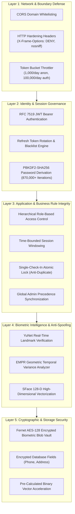
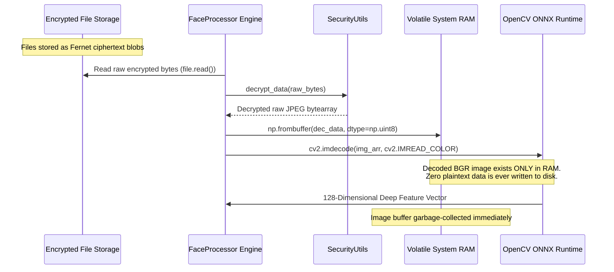
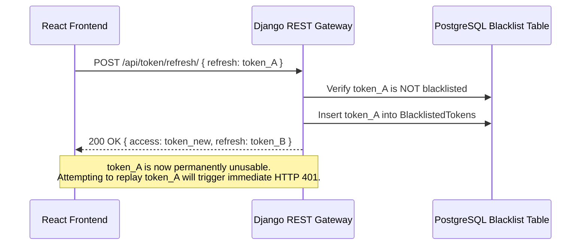

# Security & Biometric Data Privacy Engineering

## AI-Powered Smart Attendance Management System

> **Document Type:** Security Architecture & Privacy Engineering Specification  
> **Project Scope:** Final Year Project (FYP) — BS Computer Science  
> **Core Focus:** Defense-in-Depth, Cryptographic Data Protection, Zero-Plaintext Biometrics, and Privacy by Design

---

## Table of Contents

1. [Executive Summary & Security Philosophy](#1-executive-summary--security-philosophy)
2. [Defense-in-Depth Architectural Model](#2-defense-in-depth-architectural-model)
3. [Cryptographic Engineering & Data Protection at Rest](#3-cryptographic-engineering--data-protection-at-rest)
   - [3.1 Fernet Authenticated Symmetric Cipher Implementation](#31-fernet-authenticated-symmetric-cipher-implementation)
   - [3.2 Zero-Plaintext Biometric Ingestion & In-Memory Pipeline](#32-zero-plaintext-biometric-ingestion--in-memory-pipeline)
   - [3.3 Field-Level PII Cryptographic Isolation](#33-field-level-pii-cryptographic-isolation)
4. [Biometric Privacy by Design (GDPR / Institutional Alignment)](#4-biometric-privacy-by-design-gdpr--institutional-alignment)
   - [4.1 Data Minimization & Transient Frame Processing](#41-data-minimization--transient-frame-processing)
   - [4.2 One-Way Mathematical Abstraction (128-D Embeddings)](#42-one-way-mathematical-abstraction-128-d-embeddings)
5. [Identity & Token Security Architecture](#5-identity--token-security-architecture)
   - [5.1 RFC 7519 JWT with Token Rotation & Blacklisting](#51-rfc-7519-jwt-with-token-rotation--blacklisting)
   - [5.2 Industrial PBKDF2 Password Hashing](#52-industrial-pbkdf2-password-hashing)
6. [API Hardening, Boundary Defense & Transport Controls](#6-api-hardening-boundary-defense--transport-controls)
   - [6.1 Adaptive Rate Limiting & Throttling](#61-adaptive-rate-limiting--throttling)
   - [6.2 HTTP Security Headers & Clickjacking Mitigation](#62-http-security-headers--clickjacking-mitigation)
   - [6.3 Cross-Origin Resource Sharing (CORS) Isolation](#63-cross-origin-resource-sharing-cors-isolation)
7. [Passive Anti-Spoofing & Mathematical Liveness Verification](#7-passive-anti-spoofing--mathematical-liveness-verification)
8. [Session Integrity & Anti-Proxy Attendance Rules](#8-session-integrity--anti-proxy-attendance-rules)
9. [Academic Scope Boundaries & Enterprise Hardening Roadmap](#9-academic-scope-boundaries--enterprise-hardening-roadmap)

---

## 1. Executive Summary & Security Philosophy

The **AI-Powered Smart Attendance Management System** is engineered with a proactive **Security-First and Privacy-by-Design** posture. Biometric attendance solutions operating in educational and institutional settings inherently handle highly sensitive biometric identifiers and Personally Identifiable Information (PII). A failure to protect this data can expose students to identity theft, unauthorized surveillance, and privacy violations.

To address these challenges, this project implements a layered security model:

```
┌─────────────────────────────────────────────────────────────────────────────┐
│                       CORE SECURITY & PRIVACY PILLARS                       │
├──────────────────────────┬──────────────────────────┬───────────────────────┤
│   CRYPTOGRAPHIC PRIVACY  │    ZERO-PROXY INTEGRITY  │     EDGE EFFICIENCY   │
│  AES-128-CBC + HMAC-256  │  EMPR Geometric Liveness │ In-Memory Decryption  │
│ Field-Level PII & Images │ Time-Bounded Attendance  │ Transient Live Frames │
└──────────────────────────┴──────────────────────────┴───────────────────────┘
```

### Key Engineering Accomplishments
- **Zero Plaintext Storage for Biometrics:** Stored student facial enrollment datasets (`img1`–`img10`) are encrypted before being written to disk, preventing biometric harvesting in the event of an unauthorized file system dump.
- **In-Memory Volatile Processing:** Live video frames received from webcams are processed purely within RAM buffers and immediately discarded after vector extraction — **no live surveillance frames are ever cached or persisted to disk**.
- **Cryptographic Field Protection:** Student contact details (telephone numbers, residential addresses) are symmetrically encrypted at rest inside PostgreSQL.
- **Authenticated Session Governance:** All API transactions rely on industry-standard JWT tokens with automatic refresh token rotation and server-side blacklisting.
- **Strict Role-Based Scoping:** Deep queryset-level isolation ensures teachers can only view and manage their assigned students, while students are strictly restricted to their personal records.

---

## 2. Defense-in-Depth Architectural Model

The project enforces security across multiple independent boundaries. If any single layer faces an anomaly, adjacent layers maintain defensive barriers:



---

## 3. Cryptographic Engineering & Data Protection at Rest

### 3.1 Fernet Authenticated Symmetric Cipher Implementation

Data confidentiality and integrity at rest are established using Python’s authoritative `cryptography.fernet` implementation. Fernet guarantees that data encrypted cannot be read or manipulated without the secret key.

**Underlying Cryptographic Primitives:**
- **Symmetric Cipher:** AES-128 in Cipher Block Chaining (CBC) mode with PKCS7 padding.
- **Message Authentication:** HMAC using SHA-256 with an independent signing key to guarantee ciphertext integrity and authenticity.
- **Key Derivation & Structure:** 256-bit URL-safe base64 key containing a 128-bit encryption key and a 128-bit signing key.

```python
# Implementation in backend/main/security_utils.py
class SecurityUtils:
    _fernet = None

    @classmethod
    def get_fernet(cls):
        if cls._fernet is None:
            key = os.getenv('ENCRYPTION_KEY')
            if not key:
                key = Fernet.generate_key()
            cls._fernet = Fernet(key)
        return cls._fernet

    @classmethod
    def encrypt_data(cls, data) -> bytes:
        if not data: return data
        f = cls.get_fernet()
        if isinstance(data, str):
            data = data.encode()
        return f.encrypt(data)

    @classmethod
    def decrypt_data(cls, encrypted_data) -> bytes:
        if not encrypted_data: return encrypted_data
        f = cls.get_fernet()
        try:
            if isinstance(encrypted_data, str):
                encrypted_data = encrypted_data.encode()
            return f.decrypt(encrypted_data)
        except Exception:
            return None
```

### 3.2 Zero-Plaintext Biometric Ingestion & In-Memory Pipeline

When biometric multi-angle photographs are stored on the server, they represent a high-value target. The system eliminates plaintext exposure using an **in-memory streaming decryption architecture**:



**Key Architectural Security Advantages:**
1. **Zero Storage Footprint for Plaintext:** Even if the physical server hosting the backend or media directory is unmounted or compromised, raw biometric facial photographs cannot be extracted without the environment encryption key.
2. **Tamper Detection:** If an adversary attempts to modify stored images, Fernet's integrated HMAC-SHA256 signature verification instantly rejects the modified bytes.

### 3.3 Field-Level PII Cryptographic Isolation

Personally Identifiable Information (PII) including home addresses and personal telephone numbers are protected at the database row level:
- Stored as ciphertext strings inside `main_student.address` and `main_student.phone_number`.
- Transformed seamlessly via application-level hooks prior to persistence.
- Shields student records against unauthorized exposure during database backups, SQL dumps, or replica synchronization.

---

## 4. Biometric Privacy by Design (GDPR / Institutional Alignment)

### 4.1 Data Minimization & Transient Frame Processing

The architecture strictly adheres to the principle of **Data Minimization**:
- **Zero-Persistence Live Feeds:** During live classroom recognition, video frames captured by the browser canvas are transmitted as Base64 JPEG buffers to `/api/sessions/{id}/process_frame/`. The server converts the buffer to an in-memory NumPy matrix, computes the facial vector, logs the attendance status, and immediately releases the memory buffer.
- **No Video Archiving:** The system intentionally avoids recording classroom video streams or storing surveillance archives, fully eliminating the risk of historical video surveillance misuse.

### 4.2 One-Way Mathematical Abstraction (128-D Embeddings)

Once student face images are ingested during enrollment, the recognition system operates purely on **128-dimensional floating-point embeddings** generated by the SFace deep neural network:

$$\mathbf{v} = \begin{bmatrix} v_1, v_2, \dots, v_{128} \end{bmatrix} \in \mathbb{R}^{128}, \quad \|\mathbf{v}\|_2 = 1.0$$

**Privacy Benefits:**
- **Irreversibility:** High-dimensional hyperspherical embeddings are mathematical feature abstractions. Reconstructing a human-recognizable photographic face from an isolated 128-D embedding vector is computationally intractable.
- **Pickled Binary Acceleration:** Computed embeddings are serialized via `pickle` into PostgreSQL `Student.face_encodings` (`BinaryField`). This allows the system to warm up recognition memory in milliseconds without repeatedly opening or decrypting physical image files.

---

## 5. Identity & Token Security Architecture

### 5.1 RFC 7519 JWT with Token Rotation & Blacklisting

The system utilizes JSON Web Tokens (`djangorestframework-simplejwt`) for stateless, secure API communication:

| Parameter | Configuration | Security Objective |
| :--- | :--- | :--- |
| **Access Token Lifetime** | `60 Minutes` | Limits exposure window if a client token is intercepted. |
| **Refresh Token Lifetime** | `24 Hours` | Enables user convenience while maintaining session bounds. |
| **Token Rotation** | `ROTATE_REFRESH_TOKENS = True` | Issues a brand-new refresh token every time a new access token is requested. |
| **Token Blacklisting** | `BLACKLIST_AFTER_ROTATION = True` | Instantly invalidates previously used refresh tokens, neutralizing token replay attacks. |
| **Transport Header** | `Bearer <token>` | Follows RFC 6750 Bearer token authorization standards. |



### 5.2 Industrial PBKDF2 Password Hashing

User credentials for administrators, teachers, and students are protected using Django's default password security suite:
- **Algorithm:** PBKDF2 with HMAC-SHA256.
- **Work Factor:** 870,000+ hashing iterations with cryptographically random salt per user.
- **Server-Side Password Validation:** Four active validation policies enforce length, reject common dictionary passwords, prevent numeric-only entries, and reject passwords similar to user attributes.

---

## 6. API Hardening, Boundary Defense & Transport Controls

### 6.1 Adaptive Rate Limiting & Throttling

To safeguard the backend against brute-force password cracking, scraping, and denial-of-service attempts, Django REST Framework throttle classes are enforced:
- **Anonymous Throttle (`AnonRateThrottle`):** Capped at **1,000 requests/day**, protecting public endpoints (`/login_user/`, `/register_teacher/`).
- **Authenticated Throttle (`UserRateThrottle`):** Allocated **100,000 requests/day**, providing ample bandwidth for legitimate high-frequency camera frame streaming during active classroom sessions.

### 6.2 HTTP Security Headers & Clickjacking Mitigation

Production security headers configured in `backend/backend/settings.py` protect client sessions:
- `X-Frame-Options: DENY` — Prevents the dashboard from being rendered inside an external `<iframe>`, completely stopping UI redressing and clickjacking attacks.
- `X-Content-Type-Options: nosniff` — Forces browsers to respect declared MIME types, preventing executable payload injection via uploaded media files.
- `SECURE_BROWSER_XSS_FILTER: True` — Enables browser-level cross-site scripting filtering.

### 6.3 Cross-Origin Resource Sharing (CORS) Isolation

Cross-origin communications are locked down using `django-cors-headers`:
- Origin requests are strictly validated against `CORS_ALLOWED_ORIGINS` (configured via environment variables, defaulting to authorized frontend addresses like `http://localhost:3000`).
- Arbitrary cross-origin JavaScript execution is blocked at the gateway middleware layer before reaching application views.

---

## 7. Passive Anti-Spoofing & Mathematical Liveness Verification

To eliminate traditional attendance fraud through static photographic presentations (holding a printed picture or smartphone photo in front of the lens), the computer vision engine incorporates the **Eye-Mouth Position Ratio (EMPR)** geometric analysis:

### Mathematical Principle
Real human faces exhibit physiological dynamic variance (micro-saccades, breathing, natural angular oscillations). In contrast, 2D printed photographs held before a camera lens maintain completely rigid geometric proportions over time:

$$r_1 = \frac{\|\mathbf{p}_{\text{mouth\_left}} - \mathbf{p}_{\text{mouth\_right}}\|_2}{\|\mathbf{p}_{\text{eye\_left}} - \mathbf{p}_{\text{eye\_right}}\|_2}, \quad r_2 = \frac{\|\mathbf{p}_{\text{nose}} - \mathbf{p}_{\text{mouth\_mid}}\|_2}{\|\mathbf{p}_{\text{eye\_left}} - \mathbf{p}_{\text{eye\_right}}\|_2}$$

Over a temporal rolling window ($K = 10$ frames within $\Delta t \le 3.0\text{s}$), the variance is calculated:

$$\mathcal{V} = \operatorname{Var}(r_1) + \operatorname{Var}(r_2)$$

- **Static Photo Replay:** $\mathcal{V} = 0 \implies$ **Rejected as presentation spoof**.
- **Living Student:** $\mathcal{V} > 0 \implies$ **Verified as live subject**.

This passive approach requires no disruptive active prompts (like forced blinking or head-spinning), preserving an optimal, non-intrusive classroom experience.

---

## 8. Session Integrity & Anti-Proxy Attendance Rules

The business logic tier in `backend/main/views.py` establishes strict anti-fraud operational constraints:

1. **Time-Bounded Recognition:** Attendance processing is programmatically locked outside configured session hours (`start_time <= current_time <= off_time`), preventing students from marking attendance after hours.
2. **Single Daily Present Lock:** A database-level check ensures a student can only be logged as "Present" **once per calendar day**. Repeated appearances or multiple camera passes within the same day are recognized but prevented from duplicating attendance records.
3. **Automated Absentee Reconciliation:** When an instructor terminates an attendance session, the system queries enrolled students, identifies those who were not detected during the session, and automatically creates immutable `Absent` records with zero confidence.
4. **Global Administrator Precedence Lock:** If an institutional administrator initiates a campus-wide session, localized teacher sessions receive `HTTP 423 Locked`, preventing conflicting attendance records across departmental boundaries.

---

## 9. Academic Scope Boundaries & Enterprise Hardening Roadmap

As a final-year academic capstone project, the system successfully validates advanced concepts in biometric vision, applied cryptography, and role-based security. For future transition to a multi-tenant enterprise production environment, the following hardening roadmap is established:

```
┌─────────────────────────────────────────────────────────────────────────────┐
│                       ENTERPRISE HARDENING ROADMAP                          │
├──────────────────────────┬──────────────────────────┬───────────────────────┤
│   CLOUD KMS INTEGRATION  │   HTTPONLY COOKIE AUTH   │ MULTI-MODAL LIVENESS  │
│  Hardware Security Module│  Eliminates localStorage │ Depth / Texture CNN   │
│  Automated Key Rotation  │  XSS Token Theft Surface │ Replay Video Defense  │
└──────────────────────────┴──────────────────────────┴───────────────────────┘
```

1. **Enterprise Key Management Service (KMS):** Transitioning from `.env`-stored Fernet keys to cloud-native key vaults (such as AWS KMS, HashiCorp Vault, or Azure Key Vault) with automated envelope encryption and cryptographic audit trails.
2. **HttpOnly Cookie Token Storage:** Transitioning JWT token persistence from client-side `localStorage` to secure, `HttpOnly`, `SameSite=Strict` cookies to completely eliminate token accessibility by client-side JavaScript.
3. **Multi-Spectral / Depth Liveness Detection:** Augmenting the mathematical EMPR algorithm with neural texture-based anti-spoofing models or infrared/depth sensing cameras to defend against advanced video replay attacks.
4. **Automated File Orphan Cleanup:** Implementing Django post-delete signals (`post_delete`) to ensure physical encrypted image files are automatically pruned from disk whenever a student profile is deleted.

---

<div align="center">
  <b>AI-Powered Smart Attendance Management System</b><br/>
  <i>Engineered with Rigorous Cryptography, Biometric Privacy Protections, and Defense-in-Depth.</i>
</div>
