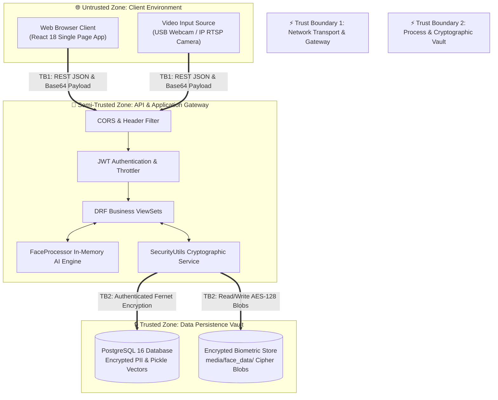
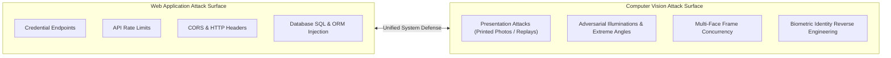
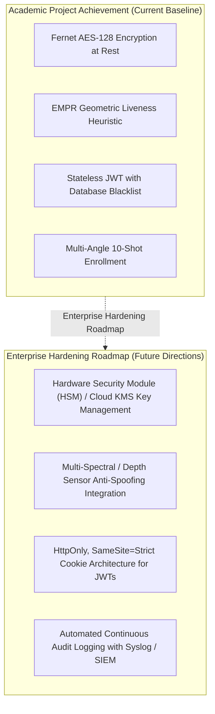

# Security Threat Model & Defense-in-Depth Analysis

## AI-Powered Smart Attendance Management System

> **Document Type:** Threat Modeling & Vulnerability Mitigation Analysis  
> **Project Scope:** Final Year Project (FYP) — BS Computer Science  
> **Methodology:** Microsoft STRIDE Security Framework (Spoofing, Tampering, Repudiation, Information Disclosure, Denial of Service, Elevation of Privilege)

---

## Table of Contents

1. [Executive Summary & Threat Modeling Methodology](#1-executive-summary--threat-modeling-methodology)
2. [System Architecture & Trust Boundary Modeling](#2-system-architecture--trust-boundary-modeling)
3. [Asset Classification & Criticality Valuation](#3-asset-classification--criticality-valuation)
4. [STRIDE Threat Analysis & Implemented Countermeasures](#4-stride-threat-analysis--implemented-countermeasures)
   - [4.1 Spoofing (Identity Deception)](#41-spoofing-identity-deception)
   - [4.2 Tampering (Data Modification)](#42-tampering-data-modification)
   - [4.3 Repudiation (Disputing Actions)](#43-repudiation-disputing-actions)
   - [4.4 Information Disclosure (Data Leakage)](#44-information-disclosure-data-leakage)
   - [4.5 Denial of Service (Resource Exhaustion)](#45-denial-of-service-resource-exhaustion)
   - [4.6 Elevation of Privilege (Unauthorized Escalation)](#46-elevation-of-privilege-unauthorized-escalation)
5. [Threat Mitigation & Security Assurance Matrix](#5-threat-mitigation--security-assurance-matrix)
6. [Attack Surface Analysis: Computer Vision vs Traditional Web](#6-attack-surface-analysis-computer-vision-vs-traditional-web)
7. [Academic Scope Boundaries & Enterprise Hardening Roadmap](#7-academic-scope-boundaries--enterprise-hardening-roadmap)

---

## 1. Executive Summary & Threat Modeling Methodology

Biometric attendance systems combine computer vision, network communication, and database storage. Consequently, they introduce attack surfaces distinct from conventional web applications, including presentation attacks (spoofed faces), biometric identity harvesting, and session replay attempts.

To systematically evaluate the security architecture of the **AI-Powered Smart Attendance Management System**, this project employs the industry-standard **STRIDE Threat Modeling Framework**, developed by Microsoft:

```
┌─────────────────────────────────────────────────────────────────────────────┐
│                         STRIDE THREAT MODEL PILLARS                         │
├─────────────────────┬─────────────────────┬─────────────────────────────────┤
│ S - Spoofing        │ T - Tampering       │ R - Repudiation                 │
│ Impersonating Users │ Modifying Data      │ Denying Recorded Actions        │
├─────────────────────┼─────────────────────┼─────────────────────────────────┤
│ I - Info Disclosure │ D - Denial of Serv. │ E - Elevation of Privilege      │
│ Exposing Biometrics │ Flooding Pipelines  │ Gaining Unauthorized Rights     │
└─────────────────────┴─────────────────────┴─────────────────────────────────┘
```

**Evaluation Objectives:**
- Identify potential attack vectors targeting the AI vision pipeline, authentication gateway, and data persistence tier.
- Formally document the defensive countermeasures implemented within the codebase.
- Provide a clear, forward-looking roadmap for enterprise hardening.

---

## 2. System Architecture & Trust Boundary Modeling

The threat model identifies three key **Trust Boundaries (TB)** that delineate trust transitions across the system:



- **Trust Boundary 1 (Network Transport):** Transitions from public client browsers to the Django REST API. Validated via CORS origin whitelisting, DRF token-bucket throttling, and JWT Bearer validation.
- **Trust Boundary 2 (Cryptographic Storage):** Transitions from runtime memory to persistent disk storage. Protected via Fernet AES-128 authenticated encryption, guaranteeing that all sensitive biometric and PII data crossing this boundary is encrypted at rest.

---

## 3. Asset Classification & Criticality Valuation

The threat model categorizes system assets by sensitivity and business impact:

| Asset Name | Format & Storage | Confidentiality | Integrity | Availability | Implemented Safeguards |
| :--- | :--- | :---: | :---: | :---: | :--- |
| **Biometric Face Photos** | JPEG files in `media/face_data/` | **High** | **High** | Medium | Authenticated Fernet AES-128 encryption; zero-plaintext storage at rest. |
| **Facial Feature Embeddings** | 128-D float vectors pickled in PostgreSQL | **Medium** | **High** | Medium | Mathematical one-way feature abstraction; cannot reconstruct original face. |
| **Student PII (Phone, Address)** | Database text fields | **High** | **High** | Low | Symmetrically encrypted at rest using application-level cryptographic hooks. |
| **JWT Session Tokens** | Cryptographic strings | **High** | **High** | Medium | Short-lived access tokens (60m), sliding refresh tokens (24h) with blacklisting. |
| **Attendance Audit Records** | Relational rows in PostgreSQL | Medium | **Critical** | **High** | Atomic single-day check-in locks; immutable check-in timestamps and AI scores. |
| **Server Master Secret** | `.env` file (`ENCRYPTION_KEY`, `SECRET_KEY`) | **Critical** | **Critical** | **High** | Isolated from version control via `.gitignore`; strictly loaded into runtime memory. |

---

## 4. STRIDE Threat Analysis & Implemented Countermeasures

### 4.1 Spoofing (Identity Deception)

Spoofing attacks attempt to impersonate legitimate students, faculty, or system services.

```
Threat S-1: Presentation Attack via Static 2D Photo or Smartphone Screen
┌─────────────────────────────────────────────────────────────────────────────┐
│ Attacker displays a printed photo or smartphone picture to proxy attendance.│
├─────────────────────────────────────────────────────────────────────────────┤
│ COUNTERMEASURE IMPLEMENTED:                                                 │
│ • EMPR (Eye-Mouth Position Ratio) Temporal Variance Filter.                 │
│ • The AI engine computes scale-invariant geometric ratios across rolling    │
│   frame windows (K = 10 frames).                                            │
│ • Flat, rigid 2D photos exhibit zero geometric variance (Var = 0) and are   │
│   automatically rejected as presentation spoofs.                            │
└─────────────────────────────────────────────────────────────────────────────┘
```

```
Threat S-2: Credential Stuffing & Brute-Force Password Attacks
┌─────────────────────────────────────────────────────────────────────────────┐
│ Adversary scripts rapid login attempts against /api/teachers/login_user/.   │
├─────────────────────────────────────────────────────────────────────────────┤
│ COUNTERMEASURE IMPLEMENTED:                                                 │
│ • DRF AnonRateThrottle restricts unauthenticated requests to 1,000/day.     │
│ • Password verification utilizes PBKDF2 with 870,000+ iterations, imposing  │
│   significant computational costs on brute-force cracking attempts.         │
│ • Django password validators enforce complex credentials at registration.   │
└─────────────────────────────────────────────────────────────────────────────┘
```

### 4.2 Tampering (Data Modification)

Tampering involves unauthorized modification of biometric files, network payloads, or database records.

```
Threat T-1: Direct Modification or Corruption of Stored Biometric Images
┌─────────────────────────────────────────────────────────────────────────────┐
│ Adversary attempts to replace or alter stored student biometric images.     │
├─────────────────────────────────────────────────────────────────────────────┤
│ COUNTERMEASURE IMPLEMENTED:                                                 │
│ • Authenticated Encryption: Fernet integrates HMAC-SHA256 signatures over   │
│   all AES-128 ciphertext blocks.                                            │
│ • Any bit-level modification or tampering with encrypted image blobs causes  │
│   instantaneous HMAC validation failure, rejecting corrupt/tampered files.  │
└─────────────────────────────────────────────────────────────────────────────┘
```

```
Threat T-2: Client-Side Session & Role Manipulation
┌─────────────────────────────────────────────────────────────────────────────┐
│ User alters 'user_role' or 'is_superuser' flags in browser localStorage.    │
├─────────────────────────────────────────────────────────────────────────────┤
│ COUNTERMEASURE IMPLEMENTED:                                                 │
│ • Defense-in-Depth: Frontend role checks only govern UI view routing.       │
│ • All API data queries are filtered server-side via Django ORM querysets    │
│   based on the authenticated user's database profile (get_queryset).        │
│ • Tampering with client state cannot grant unauthorized data access.        │
└─────────────────────────────────────────────────────────────────────────────┘
```

### 4.3 Repudiation (Disputing Actions)

Repudiation occurs when a user claims an action was falsely logged or denies modifying data.

```
Threat R-1: Student Denies Attendance Was Recorded
┌─────────────────────────────────────────────────────────────────────────────┐
│ Student disputes presence or absence records logged during a class session. │
├─────────────────────────────────────────────────────────────────────────────┤
│ COUNTERMEASURE IMPLEMENTED:                                                 │
│ • Comprehensive Audit Telemetry: Each AttendanceRecord persists:            │
│   - Millisecond-accurate check_in_time.                                     │
│   - AI match confidence percentage (mapped from cosine similarity).         │
│   - Course, section, and instructor foreign-key linkages.                   │
│   - Automated 'is_late' boolean flag based on session start boundaries.     │
│ • Single-check-in constraint ensures immutable daily records.               │
└─────────────────────────────────────────────────────────────────────────────┘
```

### 4.4 Information Disclosure (Data Leakage)

Information disclosure involves unauthorized extraction of sensitive biometric or personal data.

```
Threat I-1: Extraction of Raw Biometric Facial Images from Backups or Dumps
┌─────────────────────────────────────────────────────────────────────────────┐
│ Attacker obtains unauthorized read access to file storage or backups.       │
├─────────────────────────────────────────────────────────────────────────────┤
│ COUNTERMEASURE IMPLEMENTED:                                                 │
│ • Cryptographic Vault at Rest: Stored face images are encrypted with Fernet │
│   AES-128 before writing to disk. Plaintext images are never stored.        │
│ • Decryption occurs exclusively in volatile system RAM during active AI     │
│   inference; decrypted buffers are garbage-collected immediately.           │
└─────────────────────────────────────────────────────────────────────────────┘
```

```
Threat I-2: Harvesting of Student Telephone Numbers and Home Addresses
┌─────────────────────────────────────────────────────────────────────────────┐
│ Attacker extracts raw database tables via SQL dump.                         │
├─────────────────────────────────────────────────────────────────────────────┤
│ COUNTERMEASURE IMPLEMENTED:                                                 │
│ • Field-level encryption on 'address' and 'phone_number' columns.           │
│ • Plaintext PII is never exposed in raw database rows.                      │
└─────────────────────────────────────────────────────────────────────────────┘
```

```
Threat I-3: Inter-Classroom Privacy Leaks Between Instructors
┌─────────────────────────────────────────────────────────────────────────────┐
│ Teacher A attempts to view student records or photos from Teacher B's class.│
├─────────────────────────────────────────────────────────────────────────────┤
│ COUNTERMEASURE IMPLEMENTED:                                                 │
│ • Strict ORM Queryset Scoping: StudentViewSet.get_queryset() isolates       │
│   records using Student.objects.filter(created_by=user.teacher_profile).    │
│ • Instructors cannot view, query, or infer data from other classrooms.      │
└─────────────────────────────────────────────────────────────────────────────┘
```

### 4.5 Denial of Service (Resource Exhaustion)

DoS attacks attempt to degrade or crash the AI processing pipeline.

```
Threat D-1: High-Frequency Image Flooding of the Vision Pipeline
┌─────────────────────────────────────────────────────────────────────────────┐
│ Attacker floods /api/sessions/{id}/process_frame/ with rapid image streams. │
├─────────────────────────────────────────────────────────────────────────────┤
│ COUNTERMEASURE IMPLEMENTED:                                                 │
│ • Dual-Tier Throttling: Anonymous requests restricted to 1,000/day;         │
│   authenticated requests governed by token-bucket rate limits.              │
│ • Vectorized Cosine Inference: Using vectorized dot products over stacked   │
│   NumPy matrices executes matching in O(1) BLAS hardware primitives,         │
│   preventing CPU starvation even with large student enrollment pools.       │
│ • Time-Window Lock: Frame processing is rejected outside session hours.     │
└─────────────────────────────────────────────────────────────────────────────┘
```

### 4.6 Elevation of Privilege (Unauthorized Escalation)

Privilege escalation occurs when standard users attempt administrative actions.

```
Threat E-1: Unauthorized Execution of Administrative Actions
┌─────────────────────────────────────────────────────────────────────────────┐
│ Non-admin user attempts to toggle teacher accounts or clear system records. │
├─────────────────────────────────────────────────────────────────────────────┤
│ COUNTERMEASURE IMPLEMENTED:                                                 │
│ • Explicit Server-Side Verification: Actions such as 'toggle_active' and    │
│   'clear_records' perform strict checks on request.user.is_superuser.       │
│ • Unauthorized requests are rejected with HTTP 403 Forbidden.               │
└─────────────────────────────────────────────────────────────────────────────┘
```

---

## 5. Threat Mitigation & Security Assurance Matrix

The following matrix summarizes the threats evaluated, the mechanisms implemented, and the resulting security assurance level:

| Threat ID | Threat Vector | STRIDE Category | Defensive Mechanism Implemented | Security Assurance |
| :---: | :--- | :---: | :--- | :---: |
| **TH-01** | Photo / Screen Presentation Attack | **Spoofing** | EMPR Geometric Temporal Variance Analysis across frames | ✅ **Mitigated** |
| **TH-02** | Credential Brute-Forcing | **Spoofing** | PBKDF2-SHA256 (870,000+ iters) + DRF Rate Throttling | ✅ **Mitigated** |
| **TH-03** | Expired Session Replay | **Spoofing** | JWT Refresh Token Rotation with Database Blacklisting | ✅ **Mitigated** |
| **TH-04** | Biometric File Manipulation | **Tampering** | Fernet AES-128 with HMAC-SHA256 Authenticated Signatures | ✅ **Mitigated** |
| **TH-05** | Client-Side Role Tampering | **Tampering** | Server-side ORM Queryset Scoping (`get_queryset`) | ✅ **Mitigated** |
| **TH-06** | Attendance Record Repudiation | **Repudiation** | Millisecond Timestamps, AI Confidence Scores, Session Link | ✅ **Mitigated** |
| **TH-07** | Biometric Imagery Exposure | **Info Disclosure** | Zero-Plaintext Storage; AES-128 Encryption at Rest | ✅ **Mitigated** |
| **TH-08** | Sensitive PII Database Leaks | **Info Disclosure** | Field-Level Symmetric Cryptography on Phone & Address | ✅ **Mitigated** |
| **TH-09** | Cross-Classroom Data Leaks | **Info Disclosure** | Teacher-Specific ORM Isolation & Queryset Scoping | ✅ **Mitigated** |
| **TH-10** | Frame Processing Pipeline Flood | **Denial of Service** | Vectorized Cosine Matcher + Token-Bucket Rate Throttler | ✅ **Mitigated** |
| **TH-11** | Out-of-Hours Frame Processing | **Denial of Service** | Programmatic Time Bounds (`start_time <= now <= off_time`) | ✅ **Mitigated** |
| **TH-12** | Supervisor Privilege Escalation | **Elevation of Priv.**| Strict `is_superuser` Server Gates on Admin ViewSet Actions | ✅ **Mitigated** |

---

## 6. Attack Surface Analysis: Computer Vision vs Traditional Web

This project sits at the intersection of **Web Systems** and **Computer Vision Systems**, creating two distinct attack surfaces:



1. **Web Attack Surface:** Defended via standard engineering best practices: parameterized ORM queries (eliminating SQL injection), strict CORS whitelisting, RFC 7519 JWT rotation, and clickjacking protection via `X-Frame-Options: DENY`.
2. **Vision Attack Surface:** Defended via domain-specific computer vision engineering:
   - **Multi-Angle 10-Shot Registration:** Enrolls faces across 10 varied yaw, pitch, and roll orientations, mitigating false positives caused by unusual angles.
   - **Vectorized Normalization:** Ensures similarity comparisons are based on normalized Euclidean unit spheres, preventing illumination-induced score distortions.
   - **EMPR Geometric Variance:** Passive anti-spoofing algorithm designed specifically to detect static presentation attacks without specialized hardware.

---

## 7. Academic Scope Boundaries & Enterprise Hardening Roadmap

As an academic final-year project, the system validates core concepts in biometric computer vision, cryptographic data protection, and secure web engineering. The following roadmap outlines areas for future development when transitioning to a full enterprise deployment:



1. **Enterprise Key Management Integration:** In production, symmetric encryption keys can be managed via dedicated cloud KMS solutions (e.g., AWS KMS, HashiCorp Vault) featuring automated cryptographic key rotation and hardware security modules (HSMs).
2. **Deep-Learning Anti-Spoofing Models:** Augmenting the geometric EMPR algorithm with neural network-based presentation attack detection (PAD) trained on public datasets (e.g., CASIA-SURF, OULU-NPU) for enhanced resistance against high-definition video replays.
3. **HttpOnly Cookie Architecture:** Transitioning token transport from client-side `localStorage` to `HttpOnly`, `SameSite=Strict` cookies to further reduce cross-site scripting (XSS) attack vectors.
4. **Centralized Security Information & Event Management (SIEM):** Integrating structured application audit logs with tools like Elasticsearch or Grafana Loki to monitor anomalous authentication patterns in real time.

---

<div align="center">
  <b>AI-Powered Smart Attendance Management System</b><br/>
  <i>Structured Security Engineering, Comprehensive STRIDE Modeling, and Multi-Layered Threat Mitigation.</i>
</div>
