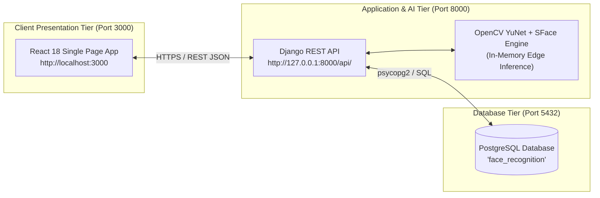

# 🛠️ System Installation & Quick-Start Guide

## AI-Powered Smart Attendance Management System

> **Document Type:** Step-by-Step Installation & Deployment Runbook  
> **Target Audience:** Developers, System Administrators, Academic Evaluators  
> **Scope:** Final Year Project (FYP) — BS Computer Science  

---

## 📑 Table of Contents

1. [Prerequisites & System Requirements](#1-prerequisites--system-requirements)
2. [Architecture Overview & Port Allocations](#2-architecture-overview--port-allocations)
3. [Step 1: Clone Repository & Workspace Preparation](#3-step-1-clone-repository--workspace-preparation)
4. [Step 2: PostgreSQL Database Setup](#4-step-2-postgresql-database-setup)
5. [Step 3: Backend Setup & Virtual Environment](#5-step-3-backend-setup--virtual-environment)
6. [Step 4: Cryptographic Key & Environment Setup](#6-step-4-cryptographic-key--environment-setup)
7. [Step 5: Database Migrations & Superuser Provisioning](#7-step-5-database-migrations--superuser-provisioning)
8. [Step 6: Frontend Client Setup (React 18)](#8-step-6-frontend-client-setup-react-18)
9. [Step 7: Launching the Unified System](#9-step-7-launching-the-unified-system)
10. [Step 8: Post-Installation Sanity Checks](#10-step-8-post-installation-sanity-checks)
11. [Troubleshooting & Common Pitfalls](#11-troubleshooting--common-pitfalls)

---

## 1. Prerequisites & System Requirements

Before beginning the installation, ensure your host development machine meets the following software and hardware requirements:

### Software Requirements
- **Operating System:** Windows 10/11, Ubuntu 20.04/22.04 LTS, or macOS 12+ (Monterey or later).
- **Python:** Version `3.10` or `3.11` (64-bit recommended). Verify with:
  ```bash
  python --version
  ```
- **Node.js & npm:** Node `v18.x` or `v20.x` LTS. Verify with:
  ```bash
  node -v
  npm -v
  ```
- **Database:** PostgreSQL `14.x`, `15.x`, or `16.x`. Verify with:
  ```bash
  psql --version
  ```
- **Git:** Git 2.30+.
- **Hardware Peripherals:** Built-in webcam or external USB camera (for biometric video stream ingestion).

---

## 2. Architecture Overview & Port Allocations

The application operates as a decoupled client-server architecture:



| Service | Default Port | Protocol | Purpose |
| :--- | :---: | :---: | :--- |
| **Frontend Web App** | `3000` | HTTP/HTTPS | React 18 User Interface & Canvas Video HUD |
| **Backend REST API** | `8000` | HTTP/HTTPS | Django REST Views, JWT Authentication & AI Engine |
| **PostgreSQL Database** | `5432` | TCP/IP | Relational Storage & Pickled Biometric Embeddings |

---

## 3. Step 1: Clone Repository & Workspace Preparation

Open your terminal or PowerShell and clone the project repository:

```bash
# Clone the repository
git clone https://github.com/yesalphahere/ai-facial-recognition-attendance-system.git

# Navigate to project root
cd ai-facial-recognition-attendance-system
```

Verify the root project directory structure contains `backend/` and `frontend/`:
```
ai-facial-recognition-attendance-system/
├── backend/          # Django REST Framework & OpenCV AI Pipeline
├── frontend/         # React 18 User Interface
├── Docs/             # Comprehensive Project Documentation
└── README.md
```

---

## 4. Step 2: PostgreSQL Database Setup

The backend utilizes PostgreSQL for persistent storage.

### 4.1 Launch PostgreSQL Shell (psql)
Log in to your PostgreSQL server as the administrator user:

```bash
# On Linux / macOS:
sudo -u postgres psql

# On Windows (via PowerShell or SQL Shell):
psql -U postgres
```

### 4.2 Create Database & Verify User
Execute the following SQL commands to provision the database:

```sql
-- 1. Create the database
CREATE DATABASE face_recognition;

-- 2. Verify or set the password for the postgres user
ALTER USER postgres WITH PASSWORD 'your_secure_db_password';

-- 3. Grant privileges
GRANT ALL PRIVILEGES ON DATABASE face_recognition TO postgres;

-- 4. Exit psql
\q
```

> [!TIP]
> Keep your PostgreSQL password handy; you will enter it into the backend `.env` configuration in Step 4.

---

## 5. Step 3: Backend Setup & Virtual Environment

Navigate into the `backend/` directory to create an isolated Python virtual environment:

```bash
cd backend
```

### 5.1 Create & Activate Virtual Environment

```bash
# Create virtual environment
python -m venv venv

# Activate on Windows (PowerShell):
.\venv\Scripts\Activate.ps1
# (Or on Windows Command Prompt):
# .\venv\Scripts\activate.bat

# Activate on Linux / macOS:
# source venv/bin/activate
```

*(Your terminal prompt should now be prefixed with `(venv)`).*

### 5.2 Install Python Dependencies
Install all required packages specified in `requirements.txt`:

```bash
pip install --upgrade pip
pip install -r requirements.txt
```

> [!NOTE]
> `requirements.txt` installs OpenCV, NumPy, Django, Django REST Framework, SimpleJWT, cryptography, and psycopg2-binary. Pre-trained ONNX models (`face_detection_yunet_2023mar.onnx` and `face_recognition_sface_2021dec.onnx`) are already stored in `backend/main/models/`.

---

## 6. Step 4: Cryptographic Key & Environment Setup

The backend requires environment variables for security keys and database connections.

### 6.1 Create `.env` from Template
Copy the `.env.example` file to create your active `.env`:

```bash
# On Windows PowerShell:
Copy-Item .env.example .env

# On Linux / macOS:
# cp .env.example .env
```

### 6.2 Generate a High-Entropy Fernet Encryption Key
Run this Python one-liner to generate a valid cryptographic Fernet key:

```bash
python -c "from cryptography.fernet import Fernet; print(Fernet.generate_key().decode())"
```
*Example Output:* `xY8s9aQ_7mN3Bw0kL1zC4vP6jR2tF5uH8eG0dI4oA1s=`

### 6.3 Edit `backend/.env`
Open `.env` in your text editor (VS Code, Notepad, Nano) and update the configuration values:

```ini
# Django Master Secret Key
SECRET_KEY=django-insecure-generate-a-secure-random-key-here

# Development Mode (Set to False in production)
DEBUG=True

# Network Hosts
ALLOWED_HOSTS=127.0.0.1,localhost

# PostgreSQL Credentials
DB_NAME=face_recognition
DB_USER=postgres
DB_PASSWORD=your_secure_db_password
DB_HOST=127.0.0.1
DB_PORT=5432

# Fernet AES-128 Encryption Key (Paste the key generated above)
ENCRYPTION_KEY=xY8s9aQ_7mN3Bw0kL1zC4vP6jR2tF5uH8eG0dI4oA1s=

# CORS Whitelist (Frontend Address)
CORS_ALLOWED_ORIGINS=http://localhost:3000
```

---

## 7. Step 5: Database Migrations & Superuser Provisioning

With the database online and `.env` configured, apply schema migrations:

### 7.1 Run Migrations
```bash
python manage.py makemigrations
python manage.py migrate
```
*Expected Output: All core and app migrations applied successfully (`[X] OK`).*

### 7.2 Create Institutional Administrator (Superuser)
Create your system administrator credentials to access the Admin Console:

```bash
python manage.py createsuperuser
```
Follow the interactive prompts:
- **Username:** `admin` (or your university email)
- **Email:** `admin@institution.edu`
- **Password:** *Enter a strong password (minimum 8 characters)*

---

## 8. Step 6: Frontend Client Setup (React 18)

Open a **second terminal window** and navigate to the `frontend/` directory:

```bash
cd ai-facial-recognition-attendance-system/frontend
```

### 8.1 Install Node.js Dependencies
Install all required npm packages:

```bash
npm install --legacy-peer-deps
```

> [!NOTE]
> The `--legacy-peer-deps` flag ensures smooth dependency resolution between React 18, React Router v6, and SweetAlert2.

### 8.2 Configure Frontend Environment
Create the frontend `.env` file from the example template:

```bash
# On Windows PowerShell:
Copy-Item .env.example .env

# On Linux / macOS:
# cp .env.example .env
```

Verify that `frontend/.env` contains the correct backend API URL:
```ini
REACT_APP_API_URL=http://127.0.0.1:8000/api
```

---

## 9. Step 7: Launching the Unified System

You will run the backend and frontend simultaneously in separate terminals:

### Terminal 1: Backend Django REST Server
```bash
cd ai-facial-recognition-attendance-system/backend

# Activate virtual environment if not already active
# Windows: .\venv\Scripts\activate
# Linux/macOS: source venv/bin/activate

python manage.py runserver
```
*Console output will display:*
```
[AI INIT] High-Performance Detector (YuNet) ready.
[AI INIT] Industrial SFace Recognition ready.
Starting development server at http://127.0.0.1:8000/
Quit the server with CTRL-BREAK.
```

### Terminal 2: Frontend React Development Server
```bash
cd ai-facial-recognition-attendance-system/frontend

npm start
```
*The default web browser will automatically open:*
👉 **[http://localhost:3000](http://localhost:3000)**

---

## 10. Step 8: Post-Installation Sanity Checks

Follow this quick walkthrough to verify your complete setup:


1. **Administrator Login:**
   - Navigate to [http://localhost:3000/teacher/login](http://localhost:3000/teacher/login).
   - Enter your superuser credentials created in Step 5.2.
   - Access the **Admin Teacher Management** page (`/admin/teachers`) to verify global administrative capabilities.
2. **Supervisor Registration:**
   - Log out and click **Sign Up** (or navigate to `/sign-up`).
   - Register a supervisor account (e.g., `dr.smith@university.edu`, Department: `Computer Science`).
3. **Multi-Angle Biometric Enrollment:**
   - Log in with the new supervisor account.
   - Go to **Student Management** (`/student-management`).
   - Click **Add Student**, enter roll number/name, and use either the **Webcam 10-Shot Capture** or upload 6–10 face photos across angles.
   - Click **Save Student**. The backend will automatically calculate and pickle the face vectors.
4. **Launch Live Recognition Session:**
   - Go to **Attendance Session** (`/attendance-session`).
   - Enter Course Name (e.g., `CS-401 Computer Vision`), select **Webcam**, set Start/End times, and click **Start Session**.
   - Look into the webcam. Within ~40ms, a high-tech cyan bounding box will appear around your face displaying your name and confidence percentage (e.g., `98.4% (Marked)`).

---

## 11. Troubleshooting & Common Pitfalls

### Issue 1: PostgreSQL Connection Refused (`psycopg2.OperationalError`)
- **Symptom:** `Is the server running on host "127.0.0.1" and accepting TCP/IP connections on port 5432?`
- **Solution:** Verify the PostgreSQL service is active:
  - *Windows:* Open `services.msc` and ensure `postgresql-x64-XX` status is **Running**.
  - *Linux:* Run `sudo systemctl status postgresql` (start with `sudo systemctl start postgresql`).
  - Verify password in `backend/.env` matches your PostgreSQL `postgres` user password.

### Issue 2: Webcam Black Screen / Permission Denied
- **Symptom:** Bounding boxes do not appear, and the webcam view is dark.
- **Solution:** 
  - Ensure browser permissions permit camera access for `http://localhost:3000` (click the lock/camera icon in Chrome's address bar).
  - Verify no other application (Zoom, Teams, Skype) is currently holding a lock on the camera device.

### Issue 3: CORS Policy Errors in Browser Console
- **Symptom:** `Access to XMLHttpRequest at 'http://127.0.0.1:8000/api/...' has been blocked by CORS policy`.
- **Solution:** Ensure `backend/.env` includes `CORS_ALLOWED_ORIGINS=http://localhost:3000` without trailing slashes. Restart the Django development server.

### Issue 4: `ModuleNotFoundError: No module named 'cv2'`
- **Symptom:** Django server crashes with missing OpenCV module.
- **Solution:** Make sure your virtual environment is active before running `pip install -r requirements.txt`. Verify via:
  ```bash
  python -c "import cv2; print(cv2.__version__)"
  ```

---

<div align="center">
  <b>AI-Powered Smart Attendance Management System</b><br/>
  <i>System Installation Complete. You are ready for live edge biometric attendance verification!</i>
</div>
