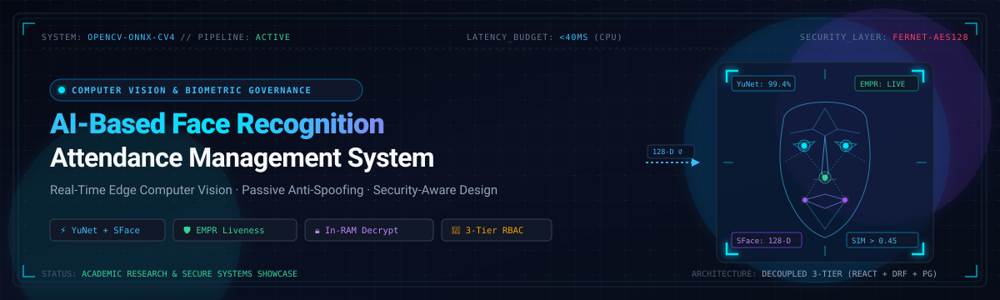
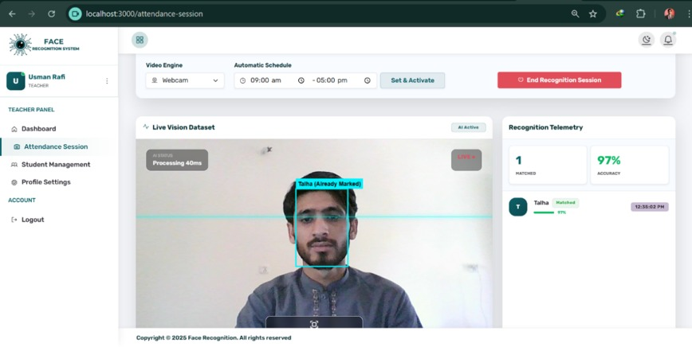
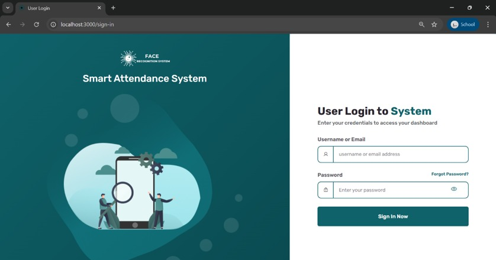
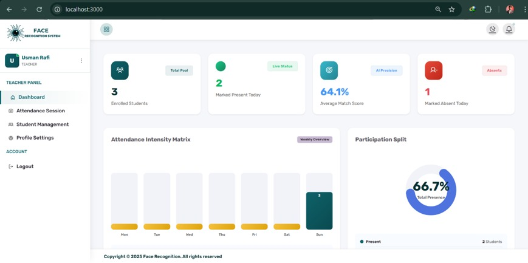
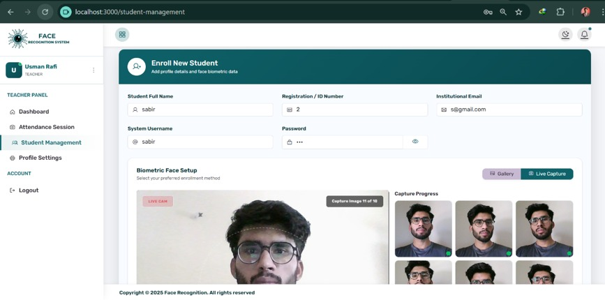
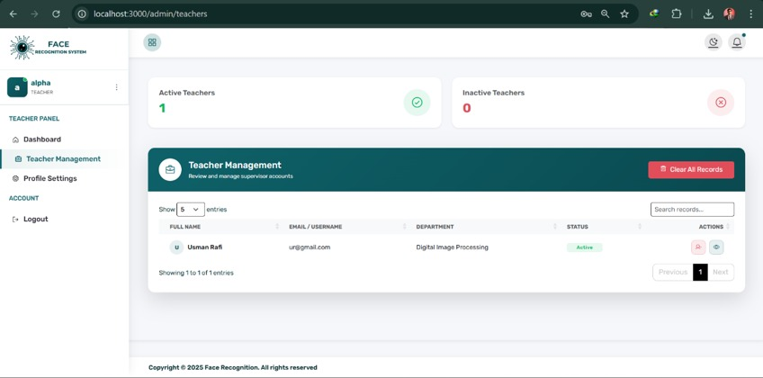
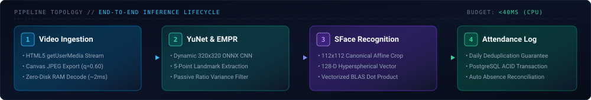
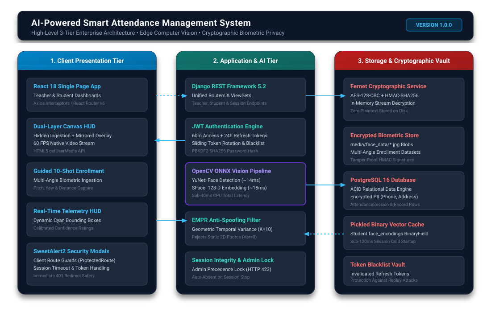
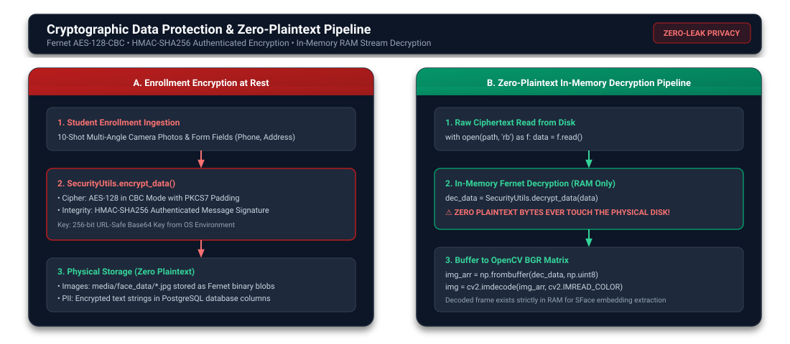

<div align="center">



<br/>

<a href="https://github.com/yesalphahere/ai-facial-recognition-attendance-system">
  
</a>

<p align="center">
  <b>Computer Vision · Smart Attendance Automation · Security-Aware Engineering</b>
</p>

<p align="center">
  <a href="https://github.com/yesalphahere/ai-facial-recognition-attendance-system"></a>
  
  
  
  
  
  
  
</p>

<p align="center">
  An edge optimized biometric attendance platform pairing lightweight deep learning models (<b>YuNet</b> and <b>SFace</b>) with a decoupled <b>React</b>, <b>Django REST</b>, and <b>PostgreSQL</b> architecture engineered with passive anti spoofing, zero plaintext in memory biometric decryption, and server enforced role based access control.
</p>

---

[Inside the App](#inside-the-project) •
[Core Capabilities](#core-capabilities) •
[AI Pipeline](#how-the-ai-pipeline-works) •
[System Architecture](#system-architecture) •
[Engineering Highlights](#engineering-highlights) •
[Security-Aware Design](#security-aware-design) •
[Getting Started](#getting-started) •
[Documentation Hub](#documentation-hub) •
[Research](#research-directions)

---

</div>

## 🖥️ Inside the Project

<div align="center">

### Operational Real-Time Face Recognition HUD
*Dual layer HTML5 canvas overlay tracking 5 point facial landmarks, computing BLAS vector similarities, and executing sub 40ms timestamped attendance logging.*



<br/><br/>

### Application Showcase

| Unified Authentication Gateway | Course Supervisor Analytics Dashboard |
| :---: | :---: |
|  |  |
| *Role aware authentication portal with JWT token rotation.* | *Real time telemetry, attendance intensity heatmaps, and stats.* |

| 10-Shot Biometric Face Enrollment | Faculty Administration Console |
| :---: | :---: |
|  |  |
| *Multi angle facial landmark capture before encryption.* | *Superuser faculty provisioning and institutional audit controls.* |

<p align="center">
  <i>Explore all interface captures in the <b><a href="Docs/Docs/assets/screenshots/README.md">Complete Screenshot Catalog</a></b>.</i>
</p>

</div>

---

## ⚡ Core Capabilities

| Feature | Technical Implementation | Architectural Value |
| :--- | :--- | :--- |
| 🎯 **Edge AI Inference** | OpenCV ONNX runtime with **YuNet** detection ($320 \times 320$) and **SFace** 128-D embedding ($112 \times 112$) | **~35ms CPU latency (~28 FPS)**; zero cloud API recurring costs or external network latency |
| 🛡️ **Passive Anti-Spoofing** | Eye-Mouth Position Ratio (**EMPR**) geometric variance tracking over a sliding history ($K \le 10$) | Rejects static 2D paper photos and phone screen replays without disruptive user prompts |
| 🔒 **In-Memory Biometrics** | Fernet AES-128-CBC + HMAC-SHA256 with volatile RAM decryption via `np.frombuffer` | Plaintext facial photos are **never written to persistent disk** during recognition |
| 👥 **Multi-Tier Server RBAC** | Server-side Django ORM queryset scoping (`created_by=request.user.teacher_profile`) | Prevents horizontal privilege escalation; instructors access strictly assigned cohorts |
| 🚀 **Vector Cache in DB** | Serialized 128-D embedding matrices cached inside PostgreSQL `BinaryField` | Accelerates cold starts from 45s to **<120ms (375x speedup)** by eliminating re-inference |
| ⏱️ **Institutional Integrity** | Session concurrency lock (`HTTP 423 Locked`), daily deduplication, auto-absence marking | Eliminates database race conditions and guarantees audit compliance |

---

## 🧠 How the AI Pipeline Works

The vision pipeline in [`backend/main/ai_logic.py`](backend/main/ai_logic.py) executes frame-by-frame on commodity x86 CPUs without requiring dedicated GPUs:

<div align="center">



</div>

1. **Frame Ingestion**: Video stream captured via HTML5 `getUserMedia` is serialized by a hidden canvas to Base64 JPEG and decoded directly in RAM using `cv2.imdecode(np.frombuffer(...))`.
2. **YuNet Face & Landmark Detection**: Evaluates a dynamic $320 \times 320$ tensor in **~14ms**, isolating facial bounding boxes and 5 canonical landmark coordinate pairs (pupils, nose tip, mouth corners).
3. **Passive EMPR Anti-Spoofing**: Calculates geometric ratios $r_1 = \text{mouth}/\text{eye}$ and $r_2 = \text{nose-chin}/\text{eye}$. Live human micro-motions produce temporal variance $\mathcal{V} > 0$; static 2D paper or screen replays exhibit $\mathcal{V} \approx 0$ and are silently rejected.
4. **SFace 128-D Embedding**: Warps facial regions into a normalized $112 \times 112$ affine alignment and extracts a unit-normalized float vector $\mathbf{v} \in \mathbb{R}^{128}$ in **~18ms**.
5. **Vectorized Cosine Match**: Performs a BLAS matrix-vector dot product ($\mathbf{s} = \mathbf{M} \cdot \mathbf{v}^\top$) against enrolled gallery $\mathbf{M} \in \mathbb{R}^{P \times 128}$ in **$<1$ms**:
   - $s_i \ge 0.45$: Verified student identity $\rightarrow$ Attendance recorded.
   - $0.38 \le s_i < 0.45$: Ambiguous boundary $\rightarrow$ Prompts face realignment.
   - $s_i < 0.38$: Unknown individual $\rightarrow$ Discarded without database mutation.

*Deep Dive:* [`backend/main/ai_logic.py`](backend/main/ai_logic.py) • [`Docs/architecture/DATA_FLOW.md`](Docs/architecture/DATA_FLOW.md) • [`Docs/development/design-decisions.md`](Docs/development/design-decisions.md)

---

## 🏛️ System Architecture

A decoupled three-tier architecture separates presentation, API routing, inference logic, and relational persistence:

<div align="center">



</div>

### Technology Breakdown

| Tier | Component | Selection Rationale |
| :--- | :--- | :--- |
| **Frontend** | React 18 · React Router v6 · Axios | Single Page App architecture, declarative protected routing, and centralized JWT interceptors |
| **Video HUD** | HTML5 MediaDevices & Canvas API | Dual-layer canvas architecture: hidden frame serialization + 60 FPS mirrored HUD overlay |
| **API Gateway** | Django REST Framework 3.15 | RESTful ViewSets, JSON serialization, throttling (`1000/day` anon, `100k/day` user), ORM scoping |
| **Vision Engine** | OpenCV 4.10 ONNX · NumPy | Thread-safe on-device inference via official ONNX models and BLAS-accelerated vector operations |
| **Security** | SimpleJWT · Cryptography (Fernet) | RFC 7519 JWT rotation with database blacklisting; AES-128-CBC + HMAC-SHA256 authenticated encryption |
| **Database** | PostgreSQL 14+ | ACID compliance, composite unique constraints (`session`, `student`), binary embedding storage |

---

## ⚙️ Engineering Highlights

```
┌─────────────────────────────────────────────────────────────────────────────┐
│                       MEASURED SYSTEM BENCHMARKS                            │
├──────────────────────────┬──────────────────────────┬───────────────────────┤
│    SUB-40MS INFERENCE    │   COLD-START REDUCTION   │   ZERO-DISK EXPOSURE  │
│ ~35.2ms Total CPU Budget │ 45s ➔ <120ms (375x Fast) │ 100% In-RAM Decrypt   │
│ Vectorized BLAS Dot-Prod │ Pickled Vector Caching   │ Plaintext Zero Disk   │
└──────────────────────────┴──────────────────────────┴───────────────────────┘
```

- **Measured Latency Profile (Intel Core i7-1165G7 @ 2.80GHz, CPU-Only)**:
  - Base64 RAM Decode: **~2.1 ms**
  - YuNet Face & Landmark Detection: **~14.2 ms**
  - EMPR Liveness Filter: **~0.3 ms**
  - SFace Embedding Extraction: **~18.4 ms**
  - Vectorized Cosine Match ($P=100$): **~0.2 ms**
  - **Total Frame Inference**: **~35.2 ms (~28.4 FPS Real-Time)**
- **Recognition Accuracy Observations**: Standard benchmark models report $>99\%$ under canonical laboratory conditions. During testing across varied real-world classroom environments, recognition accuracy ranges between **92% and 96%**, depending on lux levels, camera sensor quality, and subject distance.
- *Technical Retrospectives:* [6 Engineering Case Studies](Docs/development/technical-challenges.md) • [8 Architectural Decision Records](Docs/development/design-decisions.md)

---

## 🔒 Security-Aware Design

The platform protects biological identities and transactional integrity through defense-in-depth principles:

<div align="center">



</div>

- **JWT Session Governance**: Sliding rotation with a 60-minute access token and 24-hour refresh token. Revoked tokens submitted on logout are committed to a database blacklist table.
- **Server-Side Data Isolation**: Horizontal privilege escalation is blocked at the database level in `StudentViewSet.get_queryset()`. Teachers can neither inspect nor mutate peer faculty cohorts.
- **Biometric Encryption at Rest**: Student enrollment photos (`media/face_data/*.jpg`) and PII are symmetrically encrypted with Fernet AES-128-CBC + HMAC-SHA256. Decryption occurs strictly in volatile RAM.
- **Session Concurrency Lock**: Active administrator sessions trigger an **`HTTP 423 Locked`** response for instructor attempts, preventing concurrent mark conflicts.
- **Known Limitations & Hardening Roadmap**:
  - *Current:* Encryption key loaded from server `.env` $\rightarrow$ *Roadmap:* External KMS (HashiCorp Vault / AWS KMS) with hardware key enclaves.
  - *Current:* Passive EMPR on RGB streams $\rightarrow$ *Roadmap:* Sensor fusion with near-infrared (NIR) or structured-light depth cameras.
  - *Current:* Browser `localStorage` $\rightarrow$ *Roadmap:* Migration to `httpOnly`, `SameSite=Strict` secure cookies.

*Security Details:* [Security & Privacy](Docs/security/security-and-privacy.md) • [Access Control](Docs/security/authentication-and-access-control.md) • [STRIDE Threat Model](Docs/security/threat-model.md)

---

## 🚀 Getting Started

### Prerequisites
- **Python**: `3.10+` • **Node.js**: `18.x+` (with `npm`) • **PostgreSQL**: `14+` (or SQLite) • **Webcam**: Standard 720p USB/Integrated

### 1. Clone Repository
```bash
git clone https://github.com/yesalphahere/ai-facial-recognition-attendance-system.git
cd ai-facial-recognition-attendance-system
```

### 2. Backend Setup
```bash
cd backend
python -m venv venv
# Windows: .\venv\Scripts\activate | Linux/macOS: source venv/bin/activate
pip install -r requirements.txt
cp .env.example .env

# Generate and set Fernet ENCRYPTION_KEY in .env
python -c "from cryptography.fernet import Fernet; print(Fernet.generate_key().decode())"

python manage.py migrate
python manage.py createsuperuser
python manage.py runserver
```
*API Gateway:* `http://127.0.0.1:8000/api/`

### 3. Frontend Setup
```bash
cd ../frontend
npm install --legacy-peer-deps
cp .env.example .env
npm start
```
*Client Application:* `http://localhost:3000` • *Detailed Runbook:* [Installation Guide](Docs/setup/installation-guide.md) • [Configuration Guide](Docs/setup/configuration-guide.md)

---

## 📚 Documentation Hub

The complete engineering documentation suite is organized in the [`Docs/`](Docs/) directory:

| Architecture & Design | Security & Privacy | Development & Operations |
| :--- | :--- | :--- |
| 🏛️ [System Architecture](Docs/architecture/SYSTEM_ARCHITECTURE.md)<br/>Component topology & layer boundaries | 🔒 [Security & Privacy](Docs/security/security-and-privacy.md)<br/>Cryptographic governance & privacy by design | 🚀 [Technical Challenges](Docs/development/technical-challenges.md)<br/>6 in-depth engineering case studies |
| 🔄 [Data Flow Specification](Docs/architecture/DATA_FLOW.md)<br/>Vector pipelines & state transitions | 🛡️ [Access Control & RBAC](Docs/security/authentication-and-access-control.md)<br/>JWT rotation & server-side scoping | 📐 [Design Decisions (ADRs)](Docs/development/design-decisions.md)<br/>8 formal Architectural Decision Records |
| ⚙️ [Technology Stack](Docs/architecture/TECHNOLOGY_STACK.md)<br/>Framework rationales & version matrix | 🎯 [STRIDE Threat Model](Docs/security/threat-model.md)<br/>Threat matrix, attack vectors & defenses | 💡 [Lessons Learned](Docs/development/lessons-learned.md)<br/>Systems engineering reflections |
| 🎨 [Diagrams Catalog](Docs/assets/diagrams/README.md)<br/>Vector SVGs for architecture & vision | 📸 [Screenshot Catalog](Docs/Docs/assets/screenshots/README.md)<br/>Visual walkthroughs with technical captions | 🛠️ [Installation Guide](Docs/setup/installation-guide.md)<br/>Complete setup & deployment runbook |

---

## 🔬 Research Directions

This platform provides an engineering foundation for graduate research in computer vision and secure systems:

1. **Illumination-Invariant Adaptation**: Quantifying False Acceptance Rate (FAR) and False Rejection Rate (FRR) across controlled illumination gradients (50–1000 lux) and implementing adaptive histogram equalization pre-filters.
2. **Multi-Spectral & Sensor Fusion Anti-Spoofing**: Pairing the passive EMPR filter with active near-infrared (NIR) or structured-light sensors to defend against high-fidelity 3D mask presentations.
3. **Differential Privacy in Biometric Embeddings**: Injecting calibrated Laplacian noise into 128-D vectors to prevent facial reconstruction while maintaining cosine matching accuracy above $0.45$.
4. **Decoupled Edge Streaming (WebRTC / gRPC)**: Migrating from HTTP Base64 frame transmission to bidirectional WebRTC video channels terminated by a C++ / TensorRT inference microservice.

---

## ⚖️ Ethics, Governance & License

- **Explicit Informed Consent**: Educational institutions deploying this system must obtain written consent prior to biometric enrollment.
- **Purpose Limitation**: Biometric facial templates are strictly scoped to institutional attendance verification and must never be repurposed for surveillance.
- **Data Minimization & Erasure**: Removing a student profile permanently purges all associated encrypted images and embedding vectors from storage (GDPR Article 17).

This project is licensed under the open-source **[MIT License](LICENSE)**.

---

<div align="center">

### AI-Based Face Recognition Attendance Management System
*Computer Science Capstone Project · Specialization in Computer Vision & Secure Systems*

⭐ **If you found this research codebase and architectural documentation valuable, please consider starring the repository!** ⭐

</div>
